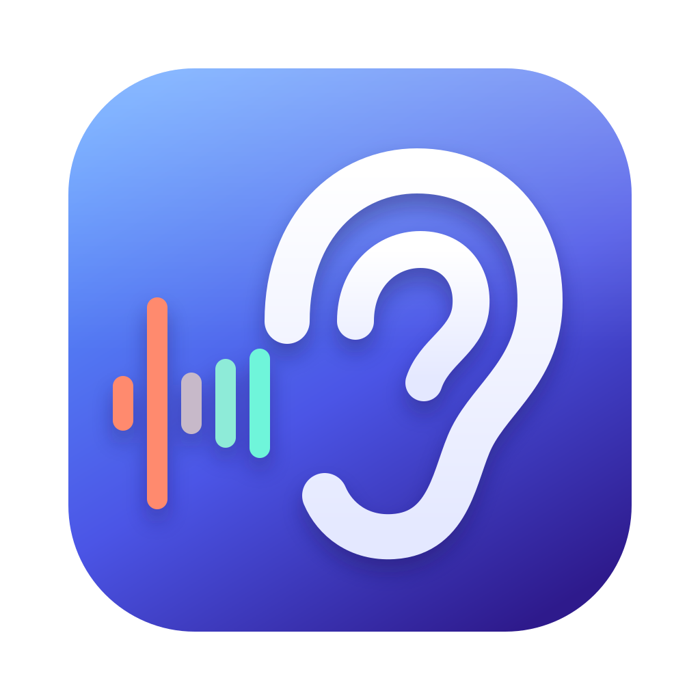
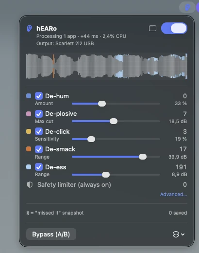
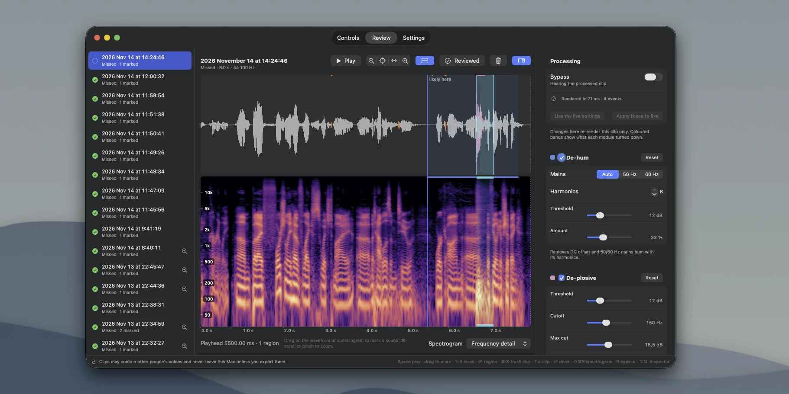

<p align="center">
  
</p>

<h1 align="center">hEARo</h1>

<p align="center">
  <strong>Real-time cleanup of everything your Mac plays.</strong><br>
  Mouth clicks, lip smacks, harsh sibilance, mains hum and plosive pops, removed before they
  reach your ears.
</p>

<p align="center">
  <a href="https://github.com/Naartti/hEARo/actions/workflows/ci.yml"></a>
  <a href="https://github.com/Naartti/hEARo/releases/latest"></a>
  <a href="https://codecov.io/gh/Naartti/hEARo"></a>
  <a href="#license"></a>
  
  
</p>

<p align="center">
  <a href="https://github.com/Naartti/hEARo/releases/latest"><strong>Download</strong></a> ·
  <a href="docs/user/INSTALL.md">Install guide</a> ·
  <a href="#build-from-source">Build from source</a> ·
  <a href="docs/README.md">Documentation</a>
</p>

hEARo is a macOS menu bar app that cleans up the sound your Mac plays — mouth clicks, lip
smacks, harsh sibilance, mains hum and plosive pops — in real time, before it reaches your
ears. It works on podcasts, YouTube, Teams, Slack huddles and anything else that plays audio,
and leaves music players alone. Everything runs locally on your Mac: no network, no telemetry.

<table>
  <tr>
    <td width="34%" valign="top">
      
    </td>
    <td valign="top">
      
    </td>
  </tr>
  <tr>
    <td valign="top"><sub><b>Menu bar.</b> One switch, a live waveform (what was removed shows in colour) and a slider per module.</sub></td>
    <td valign="top"><sub><b>Review.</b> Press <code>§</code> when something slips through; replay the snapshot, mark it and try other settings on it.</sub></td>
  </tr>
</table>

| Module | What it removes |
|---|---|
| De-hum | 50/60 Hz mains hum and its harmonics (narrow notches, speech untouched) |
| De-plosive | Low "p/b" air thumps (a dynamic low cut that acts only on the pop) |
| De-click | Tiny mouth and tongue ticks under 5 ms (detected and interpolated away) |
| De-smack | Lip smacks — the sharp, bright 5–30 ms sound of lips unsticking after a pause |
| De-ess | Harsh "s" and "sh" sounds |
| Safety limiter | Keeps true peaks under a ceiling (−1 dBTP by default); always last in the chain |

## Status

Pre-1.0, a personal project developed in the open. All six DSP modules, the live engine and
the menu bar app work, but expect rough edges and changing behaviour; the machine-learning
detector (`ml/`, `crates/hearo-ml`) is not built yet. Progress is tracked in
[docs/PROGRESS.md](docs/PROGRESS.md), changes in [CHANGELOG.md](CHANGELOG.md).

- macOS 26 (Tahoe) or later, Apple silicon only.
- macOS only; there are no plans for other platforms at the moment.

## Install

Download the DMG from the [latest release](https://github.com/Naartti/hEARo/releases/latest),
open it and drag hEARo to Applications. Releases are built by GitHub Actions from a tagged
commit, with a checksum and a build-provenance attestation. They aren't notarized by Apple, so
the first launch needs one trip to System Settings → Privacy & Security → **Open Anyway**.
Step by step, including updates: [docs/user/INSTALL.md](docs/user/INSTALL.md).

## Build from source

Requirements: an Apple silicon Mac on macOS 26+, [Homebrew](https://brew.sh), and Xcode or the
Command Line Tools (Xcode is needed for Swift tests and previews). Everything else — Rust,
Python, `just` and the other tools — is pinned in `.mise.toml` and installed by `mise`.

```sh
brew install mise
scripts/bootstrap.sh     # same as `just bootstrap`: toolchains, Python env, git hooks, then `just doctor`
just check               # fast gate: format, lint, all fast tests (Rust, Swift, Python)
just app                 # build, sign and install the app into ~/Applications
just run                 # same, then launch it and stream its logs
```

macOS ties the System Audio Recording permission to the app's code signature, so `just app`
signs with a stable identity — a free Apple Development certificate or a self-signed one.
Create it once as described in [docs/dev/SIGNING.md](docs/dev/SIGNING.md); `just doctor`
tells you what is missing. More in [docs/dev/SETUP.md](docs/dev/SETUP.md).

Without the app you can try the DSP offline with the developer CLI:

```sh
just signals             # writes reference test signals to scratch/signals
just cli process scratch/signals/speech_clicks.wav out.wav --modules declick,desmack --report
```

## How it works

A Core Audio *process tap* captures the system output (all apps except hEARo itself and an
exclusion list of music players), a private aggregate device feeds it to a real-time callback
written in Rust, and a chain of DSP modules cleans it before it plays on your current output
device. The SwiftUI app is only the user interface; it talks to the Rust engine through a small
UniFFI control plane. If anything goes wrong the engine falls back to plain passthrough — it
never leaves you in silence.

- [docs/ARCHITECTURE.md](docs/ARCHITECTURE.md) — crates, the chain, threading, fail-safes
- [docs/deep-dives/](docs/deep-dives/README.md) — learning-oriented explanations of Core Audio
  taps, real-time audio in Rust, filters, dynamics and click repair
- [docs/adr/](docs/adr/README.md) — architecture decision records
- [docs/README.md](docs/README.md) — index of all documentation

## Privacy

- **No network code, no telemetry, no analytics.** The app has no reason to go online.
- Audio is processed in memory and never recorded — with one exception: when you press the
  labeling hotkey (`§`) to say "it missed that one", hEARo saves a short snapshot of the last
  few seconds to `~/Library/Application Support/hEARo/snapshots/`. Snapshots stay on your Mac
  until you export or delete them (there is a review window for that). They may contain other
  people's voices; treat them accordingly.
- macOS asks for the **System Audio Recording** permission the first time audio plays. hEARo
  needs it to read the system output in order to process it; without it the tap only delivers
  silence and hEARo shows a "permission needed" state.

## Known limitations

- **Latency:** with every module on, hEARo adds about 44 ms (de-smack alone needs 40 ms of
  lookahead to tell a lip smack from a consonant). Video stays in sync for most viewers, but
  you may notice it on your own voice in calls. See [ADR 0012](docs/adr/0012-chain-latency-budget.md).
- Bluetooth and AirPlay outputs add their own device latency on top; AirPlay speakers are not
  yet tested.
- macOS 26+ on Apple silicon only; no Intel, no older macOS, no other operating systems.
- Releases aren't notarized: macOS asks you to allow the app once per version, and asks for
  System Audio Recording again after each update.

## Contributing

Contributions are welcome — please read [CONTRIBUTING.md](CONTRIBUTING.md) first. The whole
gate runs locally with `just check` / `just ci`, and GitHub Actions re-runs `just ci` on every
pull request ([docs/dev/LOCAL_CI.md](docs/dev/LOCAL_CI.md)); `just coverage` shows Rust test
coverage. Please follow the
[Code of Conduct](CODE_OF_CONDUCT.md), and report security issues privately as described in
[SECURITY.md](SECURITY.md).

## License

Licensed under either of [Apache License, Version 2.0](LICENSE-APACHE) or
[MIT license](LICENSE-MIT) at your option. This covers the whole repository — the Rust crates,
the Swift app in `app/`, the Python code in `ml/`, scripts and documentation.

Unless you explicitly state otherwise, any contribution intentionally submitted for inclusion
in hEARo by you, as defined in the Apache-2.0 license, shall be dual licensed as above,
without any additional terms or conditions. Third-party notices:
[THIRD_PARTY_NOTICES.md](THIRD_PARTY_NOTICES.md).
