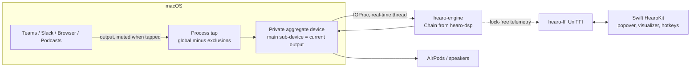
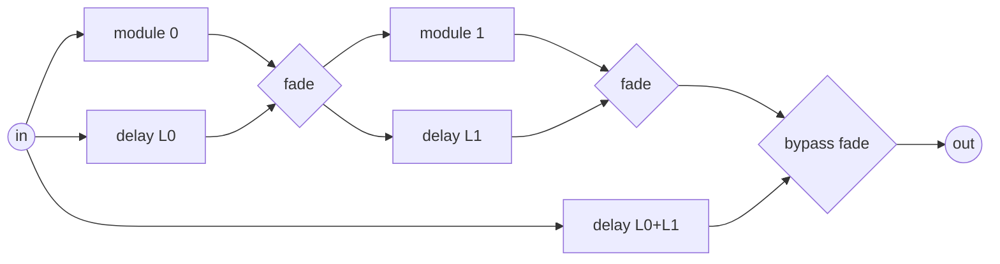
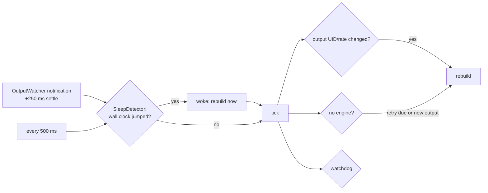

# Architecture

See also: [ADRs](adr/README.md), [HANDOVER §4](HANDOVER.md), deep dives in [deep-dives/](deep-dives/README.md).

## Overview

## Crates

| Crate | Role | Status |
|---|---|---|
| `hearo-dsp` | `AudioBlock`, `Module`, `Chain`, analysis, modules. No OS deps. | M1 done |
| `hearo-testkit` | Seeded signals, metrics, WAV, allocation counter | M1 done |
| `hearo-cli` | `hearo gen-signals / process / inspect` | M1 done |
| `hearo-engine` | Core Audio tap + aggregate device + IOProc, watchdog | M2 |
| `hearo-ffi` | UniFFI control plane | M3 |
| `hearo-ml` | Streaming model runner | M8 |

## The chain (`crates/hearo-dsp/src/chain.rs`)

Order: `DC/hum → de-plosive → de-click → de-smack → de-ess → limiter`.

- **Constant latency.** Each slot runs a dry delay equal to its module's lookahead, so total
  latency is the sum of all lookaheads whether modules are on or off. Toggling never shifts time.
- **Toggles live in the chain, not in modules** (deviation from HANDOVER §4.4's
  `Module::set_enabled`): every module gets click-free 10 ms raised-cosine fades for free.
  Enabling a lookahead module first *warms up* (runs it, outputs dry) for `latency` samples so
  the fade never crossfades into an empty lookahead buffer.
- **Bit-exact bypass.** Disabled slots and full bypass output copies of delayed input; property
  tests assert exact equality (from `toggle + fade + latency` onward when toggled mid-stream).
  Under *global* bypass modules keep running so A/B is instant; *disabled slots* don't run.
- **Fail-safe** (each case increments `faults`):
  - non-finite *input* samples are zeroed before they reach any delay line (so they can't linger);
  - a module whose output is non-finite is replaced by its delayed dry signal for that block and
    reset — other modules are untouched;
  - unprepared chain or channel mismatch → untouched passthrough.
- **Denormals.** `Chain::process` sets flush-to-zero for its duration (`DenormalGuard`, aarch64
  FPCR.FZ) so decaying IIR tails can't slow the audio thread.
- **Any block size.** Blocks larger than `max_block` are processed in chunks; output is
  bit-identical regardless of block sizes (property test).

## Module catalog

Each module describes itself for UIs: `ParamDesc` (key, name, unit, min/max/default, `step`
— 0 = continuous — and discrete `choices`, e.g. de-hum mains Auto/50/60 Hz) plus
`Module::primary_param()`, the one "how much is removed" control of the simple UI:

| Module | Primary param | Meaning |
|---|---|---|
| de-hum | `amount` 0..1 | notch depth (hum −20·log10(1 − amount) dB) |
| de-plosive | `max_cut` dB | deepest low cut |
| de-click | `sensitivity` 0..1 | a repair has no depth: more sensitive = more clicks repaired |
| de-smack | `range` dB | deepest duck (0 = detect only) |
| de-ess | `range` dB | deepest sibilance cut |
| limiter | — | always on; ceiling is an advanced setting |

`ParamDesc::snap` (clamp + step/choice) is the one rule for legal values; modules apply the same.

## Control plane: modules, parameters, settings (hearo-ffi, ADR 0015)

- `module_catalog()` → `ModuleInfo { key, name, description, cleanup, always_on, primary_param,
  params: [ParamInfo { key, name, unit, min, max, default_value, step, choices, primary }] }`.
- `HearoEngine.set_param(module_key, param_key, value)`: clamped + snapped, stored in the FFI's
  `ModuleState`, written to the lock-free `Controls` atomics; the IOProc applies changed values
  at the start of its next cycle. `set_module_enabled` works the same way (the limiter stays on).
- `settings()` / `apply_settings(EngineSettings)`: all enabled flags and values. `ModuleState`
  is pushed into every new engine's `Controls` before audio flows, so settings survive
  output-device rebuilds. Bypass is separate and not persisted.
- Persistence: the app stores the same JSON (`settings_to_json` shape; Swift `Codable`
  `EngineSettings`, so HearoKit needs no FFI) in `~/Library/Application Support/hEARo/settings.json`
  (`HearoKit/ModuleSettingsModel.swift`: atomic, debounced, applied before start) and hands it
  back through `apply_settings`, which ignores unknown keys, defaults missing ones and
  clamps/snaps values. `settings_from_json(...)` / `default_settings()` do the same in Rust.
- `waveform(since, max)` → `WaveformChunk { next, peaks, removed, output_peaks, reductions:
  [ModuleReduction { key, gain_reduction_db }] }` (cleanup modules, chain order).
- `render_clip(wav_path, out_wav_path, settings, bypass, columns_per_second)` → `RenderReport`
  (processed WAV aligned with the input, input/output peaks, per-module reduction rows, events).
  Stateless; call it off the main thread.

## Offline rendering

`hearo_dsp::offline::render` runs a fresh chain over a whole clip, latency-compensated (output
lines up with the input sample for sample), and optionally returns per-column input/output peaks
and per-cleanup-module gain reduction on the clip's timeline (each module's meter is shifted back
by the lookahead up to and including its slot). `hearo process` and the review window's
`render_clip` both use it.

## Real-time threading

| Thread | Allowed to |
|---|---|
| Core Audio IOProc | read tap, run chain, write output, lock-free telemetry only |
| ML worker (optional) | inference from an SPSC ring, in the device's audio workgroup |
| Engine control (`hearo-supervisor`) | build/rebuild tap + aggregate device, watchdog, wake detection |
| Swift main | UI, hotkeys, UniFFI polls (never > 1 ms; may wait while a rebuild holds the lock) |

**The supervisor** (`hearo_engine::supervisor`, [ADR 0014](adr/0014-engine-supervisor-watchdog-and-wake.md)).
All recovery policy is pure control logic over an `AudioBackend` trait (start tap + aggregate +
IOProc, "output changed?", controls, callback counters, "are tapped apps playing?").
`LiveBackend` is the Core Audio implementation; `supervisor::fake::FakeBackend` scripts device
switches, start failures, dead/silent IOProcs and sleep for unit tests with an injected clock.
The supervisor owns the engine and the user's settings (bypass, toggles, params) and re-applies
them to every new engine. It always drops the old engine before building a new one, and
whenever no engine exists there is no tap, so macOS plays everything normally — never silence.
In the app, the `hearo-supervisor` thread in `hearo-ffi` drives it:

- **Following the output** (2026-11-14). The aggregate plays to one device, so a new system
  output (AirPods, Sonos picked in Control Center, a DAC unplugged, a sample-rate change)
  needs a new tap + aggregate. `ca::watch::OutputWatcher` registers Core Audio listeners for
  the default output and the device list; they only bump a counter. On a settled change (or
  every tick) the supervisor rebuilds if `LiveEngine::output_changed()` (UID or nominal rate).
- **Failed starts** (device not ready, unusable) are reported in `EngineStatus.problem` and
  retried after 3 s, doubling to at most 30 s; a *different* default output or a wake retries
  at once. A device notification alone doesn't — creating/destroying our own aggregate fires
  one too, which would otherwise defeat the backoff and the give-up.
- **Zero-buffer watchdog.** Zero callbacks is normal while nothing plays (ADR 0010), so the
  watchdog only acts when tapped processes report `kAudioProcessPropertyIsRunningOutput`
  (hEARo itself and the tap's exclusions don't count; nothing is judged while the permission
  is `NotDetermined`). No callbacks for 2 s → rebuild; again after 2 s → rebuild; after 4 s
  more → give up: tear down (passthrough) and show the problem until the user toggles hEARo,
  the output changes or the Mac wakes. Only-digital-silence callbacks → rebuild with backoff
  2 s → 60 s, never give up (a silent call is legitimate; rebuilding silence is inaudible).
  Sound or idle ends the episode.
- **Sleep/wake.** `Instant` stops during sleep, the wall clock doesn't: a ≥ 3 s divergence
  between ticks (or a ≥ 30 s gap) counts as a wake, and the supervisor rebuilds unconditionally.

`hearo run` still follows the output in its own loop (no watchdog yet). Hardware tests:
`just test-hw`.

Parameters flow UI → audio through atomics / an `rtrb` command queue drained at block start;
telemetry flows audio → UI through atomics, `triple_buffer` and `rtrb`.

**Live waveform** (`hearo_engine::waveform`, 60 columns/s). Each column, aligned with the output
that is playing, holds the original peak, the processed peak and, per cleanup module
(`ModuleId::CLEANUP`: de-hum, de-plosive, de-click, de-smack, de-ess), the largest gain
reduction in the column. A module's meter describes its *own* output block, so the builder
delays it by the lookahead of the slots after it (the input peak by the whole chain latency).
Packed into two `AtomicU64` per column (peaks as u16, reductions as u8 in 0.25 dB steps,
0–63.75 dB; ADR 0015); single writer, the reader stays half the 4096-column ring behind.
Gain reduction is 0 for slots that are off or warming up and under global bypass. "Removed"
(the old red flag, no longer drawn) = some module cut more than 1 dB; the app colours each module's share instead (DESIGN.md, *Module colours*).

**Detection events** (`hearo_engine::events::EventRing`, 2026-11-14). After each cycle the IOProc
copies the chain's events (module, kind, start sample, length, dB removed) into a 1024-slot
lock-free SPSC ring (relaxed slot stores, published by a Release `head`; a full ring drops and
counts, never waits) and clears them. `LiveEngine::drain_events` reads them on one control
thread. An event's `start_sample` is on the chain's input clock, which is the capture ring's
frame clock (both see every frame in the same chunks), so `LiveEngine::capture_window` can cut
unprocessed audio around it — the basis of auto-saved de-smack catches (ADR 0018). Events mean
"removed": the chain drops (and uncounts) events a warming-up or fading-out slot reports for
audio that leaves it while its output is fully dry (a lookahead module still detects then;
2026-11-15), and the IOProc publishes none under global bypass. The per-module trigger counts in
`Stats` (the popover's "removed" count, the menu bar's `.removing` glow) count the same events:
they stand still, and the reduction meter reads 0, while bypassed. The
`hearo-supervisor` thread drains the ring every tick (even with auto-save off), runs
`hearo_engine::autocapture` under the engine lock, and writes the clip (`snapshots::save_auto`)
after releasing it; an hourly sweep deletes untouched auto clips past their retention.

## Data layout

`AudioBlock` is planar: one contiguous slice per channel (up to 8). The engine de-interleaves
Core Audio buffers into pre-allocated planar scratch. Sub-blocks are re-borrows, never copies.

## App

`app/Package.swift` defines `HearoKit` (all views, view models, `Engine` protocol, `FakeEngine`)
and a thin `@main` target. `just app` builds it with SwiftPM, assembles and signs the bundle
(ADR 0004). `app/project.yml` generates an Xcode project on demand.
