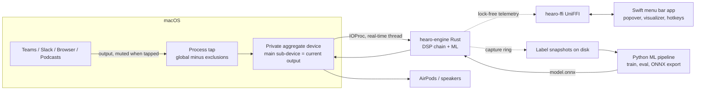

# hEARo — Project Handover & Autonomous Build Brief

> **For the human:** create an empty folder, `cd` into it, run `git init`, start Claude Code, and paste this entire file as the first message. Optionally save it as `docs/HANDOVER.md` too. Claude Code will bootstrap the repo, then build hEARo milestone by milestone, committing as it goes. It will stop only at the **Human Checkpoints** listed in §15.

---

## 0. Your role and how to work

You are the lead engineer on **hEARo** (hero + ear). You are a senior Rust audio/DSP engineer, a senior macOS/Swift engineer, and a pragmatic ML engineer. You work **autonomously and continuously** through the milestones in §14. Commit small, test everything, and document as you go.

### 0.1 The work loop (follow for every task)

1. **Orient.** Read `AGENTS.md`, `docs/PROGRESS.md`, and `git log --oneline -20`. Pick the next unchecked task.
2. **Plan briefly.** Write 3–8 lines in your scratch reasoning. For any non-trivial design choice, write an ADR in `docs/adr/` (template in §12.3).
3. **Test first.** Write or extend a failing test that defines "done" for the task.
4. **Implement** the smallest change that makes it pass.
5. **Verify.** Run `just check` (format, lint, all fast tests). Never commit red.
6. **Document.** Update the relevant doc in `docs/` in the same commit as the code. Code and docs never drift.
7. **Commit** using Conventional Commits (`feat(dsp): add de-hum notch comb`, `test(engine): ...`, `docs(deep-dive): ...`). One logical change per commit.
8. **Record progress.** Tick the box in `docs/PROGRESS.md` and add a one-line note (what was done, anything surprising). Commit it.
9. **Continue** with the next task. At each milestone end, run the milestone review (§12.5), tag `mN-done`, and move on.

### 0.2 Autonomy rules

- **Don't stop to ask** about anything you can decide with good engineering judgment. Decide, record the decision in an ADR or `docs/PROGRESS.md`, and continue.
- **When blocked** on something only a human can do (§15), write it in `docs/OPEN_QUESTIONS.md`, notify the human clearly, and **continue with the next unblocked task**. Many milestones can progress in parallel; for example, DSP work (M1, M4) doesn't need audio permissions.
- **Verify, don't trust memory.** Before adding any dependency or tool, check its current version and API (`cargo search`, `cargo info`, docs.rs, `brew info`, release pages). Pin exact versions. APIs change; your training data may be stale.
- **Context hygiene.** Keep sessions focused. Before context gets large, make sure `docs/PROGRESS.md` is current so a fresh session can resume from it alone. Use subagents (§12.4) for reviews and wide searches.
- **Never** weaken a test to make it pass, delete failing tests, or disable lints without an ADR explaining why.
- **Never** commit secrets, signing certificates, datasets, recorded audio, or model weights larger than 5 MB (use Git LFS only if an ADR justifies it).

---

## 1. Product vision

hEARo is a **macOS menu bar app** that processes **system audio before it reaches the user's ears** and removes annoying sounds in real time: mouth clicks, lip smacks, wet mouth noises, harsh sibilance, hum, and plosives. It works for podcasts, YouTube, Microsoft Teams calls, Slack huddles, and any other app.

The user is a hobby musician (comfortable with EQ, compression, de-essing) and a full-stack developer moving into data science. The project should be useful every day **and** a learning vehicle, so the deep-dive documentation (§11) is a first-class deliverable, not an afterthought.

### 1.1 Core features

1. **System-wide processing** with per-app control: process Teams, Slack, browsers, and podcast apps; leave music apps and DAWs untouched.
2. **Modular processing chain** with on/off toggles in the menu bar: De-hum, De-ess, De-click, De-plosive, De-smack (ML), and a safety limiter.
3. **Menu bar popover** with live stats: trigger counts per module, gain reduction, latency, CPU, buffer underruns.
4. **Live real-time visualization** showing exactly how each module changes the sound: pre/post spectrum, "removed energy" fill colored by module, module curves (notches, dynamic bands), and an event timeline.
5. **Labeling hotkeys** for building a personal dataset: one hotkey means "something annoying just happened that hEARo missed", another means "hEARo removed something it shouldn't have". Each press saves the last few seconds of unprocessed audio plus detector state.
6. **Dataset review window** to inspect labeled snapshots on a spectrogram and mark exact regions.
7. **ML de-smack model** trained in Python on synthetic mixes plus the user's labeled clips, exported to ONNX, and run in Rust in real time.

### 1.2 Non-goals (v1)

- No App Store distribution. A normal, signed `.app` installed in `/Applications`, delivered as a DMG.
- No virtual audio drivers, HAL plugins, or kernel extensions.
- No microphone processing (the input side may come later).
- No cloud, telemetry, or network access of any kind. Everything is local.
- Intel Macs and macOS versions before 26 are not supported.

---

## 2. Hard constraints

| Constraint | Detail |
|---|---|
| Platform | macOS 26 (Tahoe) or later, Apple Silicon only. Dev machine: MacBook Pro M5. |
| Audio capture | Core Audio **process taps** + private aggregate device. No drivers. |
| Real-time safety | The audio callback never allocates, locks, blocks, does I/O, logs, or panics. Enforced by tests (§10.2). |
| Latency budget | Target ≤ 30 ms added end-to-end (excluding Bluetooth's own latency); hard ceiling 45 ms. Show the live value in the UI. |
| CPU budget | Whole chain (including ML) ≤ 5% of one performance core at 48 kHz stereo. Benchmarks enforce a per-block budget. |
| Fail-safe | If processing fails, overruns repeatedly, or the engine stalls, fall back to **bit-exact passthrough** or tear down the tap so macOS restores normal audio. The user must never be left in silence. |
| Privacy | No network entitlement and no network code. Labeled snapshots stay in `~/Library/Application Support/hEARo/`. |
| Licenses | Only permissive dependencies (MIT, Apache-2.0, BSD, ISC, Zlib). Enforced by `cargo-deny`. If you adapt code from AudioCap (BSD-2-Clause), keep its notice in `THIRD_PARTY_NOTICES.md`. |

---

## 3. Verified platform facts (research summary — rely on these, but re-verify APIs)

### 3.1 Capturing and replacing system audio

- Since macOS 14.2, `AudioHardwareCreateProcessTap(CATapDescription)` creates a tap on one or more processes' output. A tap can **mute the process output** so the audio goes only to the tap. Mute behaviors: `Unmuted`, `Muted`, `MutedWhenTapped` (muted only while someone reads the tap). **Use `MutedWhenTapped`**: if hEARo stops reading, audio automatically returns to normal. This is a key part of the fail-safe.
- A tap is read by adding its UID to an **aggregate device** (`kAudioAggregateDevicePropertyTapList`) and running an IOProc on that device. Make the aggregate device **private** so it disappears when the process exits.
- **Best-practice topology (used by the open-source Rust tool `eqtune` and the app `Split`):** one private aggregate device containing **the current output device as main sub-device** plus the tap. Tap and output share one clock, so there's no resampling or drift. A single IOProc reads tap input, processes it, and writes to the device output.
- `CATapDescription` supports "global tap but exclude processes" (stereo mixdown of everything except a list). **Always exclude hEARo's own process**, or you create a feedback loop. Default to global-tap-minus-exclusions, with an exclusion list for music apps and DAWs.
- On macOS 26+, `CATapDescription.bundleIDs` can select or exclude processes by bundle ID. Prefer this over PID lists where it works.
- `Info.plist` must contain `NSAudioCaptureUsageDescription`. The first time the aggregate device starts, macOS shows the "System Audio Recording" permission prompt. **If permission is missing, the tap returns silence, not an error.** Detect this case explicitly and show it in the UI.
- Rust bindings exist: `objc2-core-audio` (raw bindings including `CATapDescription`, `CATapMuteBehavior`) and a higher-level crate `coreaudio` (0.3.x) with `ProcessTap` and `AggregateDevice::with_tap`. Evaluate the high-level crate first, fall back to `objc2-core-audio` if it's missing something, and record the choice in an ADR.

### 3.2 Which processes play the audio

- **Electron and Chromium apps (Slack, Teams, Discord) and browsers play audio from helper processes**, not the main app process. Tapping only the main PID captures nothing. Global-tap-with-exclusions avoids this problem entirely. For per-app include mode, group processes by bundle ID prefix (for example `com.tinyspeck.slackmacgap*`) and refresh the tap when new helper processes appear (listen to `kAudioHardwarePropertyProcessObjectList`).
- Safari plays audio through WebKit helper processes (`com.apple.WebKit.*`). Resolve these to "Safari" in the UI.
- Build a diagnostic CLI command (`hearo procs --watch`) that lists audio-producing processes with PID, bundle ID, and whether they're running output. This is essential for debugging app coverage.

### 3.3 Robustness issues reported by other developers

- Taps have been reported to deliver **all-zero buffers** after running for a long time while audio was still audible, correlated with sample-rate changes (44.1 ↔ 48 kHz) and Bluetooth sleep/wake. The reported reliable recovery is to **destroy and recreate both the tap and the aggregate device**; restarting only the IOProc is not enough.
- Implement a **watchdog**: if the tap delivers digital silence while processes report active output for more than N seconds, rebuild the chain and record the event in the stats.
- Rebuild the chain on: default output device change, sample rate change, device disappearance, and AirPods sleep/wake. Coalesce bursts of Core Audio notifications (debounce about 250 ms).
- Multi-channel devices (for example audio interfaces with 4 stereo pairs) can produce **level attenuation** in the tap (−12 dB was reported for an 8-output device). Built-in speakers and AirPods (2 channels) show no attenuation. Measure it, compensate when detected, and document it.

### 3.4 AirPods and Bluetooth

- AirPods work. The aggregate device uses them as the main sub-device. Bluetooth adds its own latency (outside our budget); the UI should show hEARo's added latency separately from device latency.
- Including a Bluetooth device in the aggregate increases tap latency; this is expected.
- **If a call app uses the AirPods microphone, macOS switches the AirPods to the low-quality call profile.** This happens without hEARo too. Mention it in the user docs and suggest using the Mac's microphone with AirPods output during calls.

### 3.5 Code signing and the permission problem (important for dev experience)

- Permissions (TCC) are tied to **bundle ID + code signature**. Ad-hoc signing (`codesign --sign -`) pins the grant to the build's cdhash, so **every rebuild silently loses the permission** while System Settings still shows it as enabled.
- Therefore, dev builds must be signed with a **stable identity**: an "Apple Development" certificate (free with an Apple ID via Xcode) or a self-signed code-signing certificate created in Keychain Access, with a fixed bundle ID (`dev.hearo.app.dev` for dev, `dev.hearo.app` for release) and a fixed install path. The signing script refuses ad-hoc signing unless `ALLOW_ADHOC=1` is set.
- Release builds outside the App Store need a "Developer ID Application" certificate (paid Apple Developer Program), Hardened Runtime, `notarytool` notarization, and `stapler`. Without the paid program, the app still works on this Mac with the dev identity. Notarization is optional (§16.3).

---

## 4. Architecture

### 4.1 Overview



### 4.2 Key decisions (write each as an ADR in M0)

1. **Rust owns the entire audio path**, including Core Audio tap setup, aggregate device, IOProc, DSP, and ML inference. Swift owns only the UI. Reasons: the real-time path stays in one language with one set of safety guarantees; the engine is fully testable headlessly through a CLI; and agents can run, test, and benchmark it without a GUI.
2. **Swift ↔ Rust via UniFFI** for the control plane only (start/stop, toggles, parameters, telemetry snapshots, process lists). UniFFI calls are never made from the audio thread.
3. **Telemetry flows one way**, from audio thread to UI, through lock-free structures: atomics for scalar meters, a `triple_buffer` for spectrum frames, and an `rtrb` SPSC ring for discrete events (click detected at t, smack removed at t). The UI polls 60 times per second through UniFFI on the main thread.
4. **Parameters flow the other way** through atomics (`AtomicF32` per parameter) or an `rtrb` command queue drained at the start of each block. Never through locks.
5. **One process, no daemon** in v1. The engine runs inside the menu bar app. The CLI (`hearo`) links the same engine for development and headless testing.
6. **Offline-first DSP.** Every module implements a pure `process(&mut self, block)` that works identically on live audio and on WAV files. All quality tests run offline and deterministically on generated test signals.

### 4.3 Real-time threading model

| Thread | Owner | Allowed to |
|---|---|---|
| Core Audio IOProc (real-time) | Core Audio | Read tap input, run the chain, write output, push telemetry with lock-free writes only. |
| ML worker (optional, real-time-ish) | engine | Run model inference on frames from an SPSC ring. Join the device's **audio workgroup** (`os_workgroup`, from `kAudioDevicePropertyIOThreadOSWorkgroup`) for proper scheduling. Used only if inference doesn't fit inline (§7.6). |
| Engine control | engine | Build/rebuild tap and aggregate device, handle device-change notifications, watchdog, write label snapshots to disk. |
| Swift main thread | app | UI, hotkeys, UniFFI calls (never blocking for more than 1 ms). |

### 4.4 Processing chain (order matters; document why in the deep dive)

`input → DC/hum removal → de-plosive → de-click → de-smack (ML) → de-ess → safety limiter → output`

Every module implements this trait (adapt as needed):

```rust
pub trait Module: Send {
    fn id(&self) -> ModuleId;
    fn prepare(&mut self, sample_rate: f32, max_block: usize, channels: usize); // may allocate
    fn reset(&mut self);
    fn latency_samples(&self) -> usize;          // for lookahead / PDC
    fn process(&mut self, block: &mut AudioBlock, telemetry: &mut TelemetryWriter); // RT-safe
    fn set_enabled(&mut self, on: bool);          // crossfades over ~10 ms, never clicks
    fn params(&self) -> &[ParamDesc];
}
```

The chain compensates latency so that a module toggled off keeps the timing aligned (a delay line instead of a jump). Bypassing the whole chain must be **bit-exact passthrough** after compensation, and a test enforces this.

---

## 5. Repository layout

```
hearo/
├── AGENTS.md                  # Single source of truth for agent instructions (§12.1)
├── CLAUDE.md                  # "@AGENTS.md" + Claude-specific notes (§12.2)
├── README.md                  # User-facing: what, install, use, uninstall
├── THIRD_PARTY_NOTICES.md
├── justfile                   # All commands (§8.2)
├── .mise.toml                 # Pinned toolchains: rust, python, uv, just, etc.
├── lefthook.yml               # Git hooks
├── rust-toolchain.toml
├── Cargo.toml                 # Workspace
├── deny.toml                  # cargo-deny: licenses, advisories
├── .claude/
│   ├── settings.json          # Permissions allowlist + hooks (§12.4)
│   ├── agents/                # Subagents (§12.4)
│   └── skills/                # Project skills (§12.4)
├── .vscode/                   # settings.json, extensions.json, launch.json, tasks.json
├── .github/workflows/ci.yml
├── crates/
│   ├── hearo-dsp/             # Pure DSP: modules, chain, analysis (FFT, bands). No OS deps.
│   ├── hearo-ml/              # Streaming model runner (tract/ort), feature extraction
│   ├── hearo-engine/          # Core Audio taps, aggregate device, IOProc, watchdog, capture ring, telemetry
│   ├── hearo-ffi/             # UniFFI bindings for Swift (control plane only)
│   ├── hearo-cli/             # `hearo` binary: procs, run, process, gen-signals, bench, inspect
│   └── hearo-testkit/         # Test signal generators, metrics, golden-file helpers
├── app/
│   ├── project.yml            # XcodeGen spec. The .xcodeproj is generated, never hand-edited, git-ignored.
│   ├── hEARo/                 # SwiftUI app: MenuBarExtra, views, view models
│   ├── hEARoTests/            # Swift Testing unit tests + snapshot tests
│   ├── Resources/             # Assets, Info.plist, entitlements, icon sources (SVG)
│   └── RustBridge/            # Generated UniFFI Swift + XCFramework (generated, git-ignored)
├── ml/
│   ├── pyproject.toml         # uv-managed
│   ├── hearo_ml/              # data, mixing, augmentation, models, train, eval, export
│   ├── tests/                 # pytest
│   ├── notebooks/             # Exploratory, outputs stripped (nbstripout)
│   └── data/                  # git-ignored; manifests + checksums are committed
├── models/                    # Small exported ONNX models (< 5 MB) + model cards
├── scripts/                   # build-xcframework.sh, sign.sh, package-dmg.sh, notarize.sh, uninstall.sh
├── testdata/                  # Small generated reference WAVs + golden metrics (JSON)
└── docs/                      # Doc-as-code (§11)
```

---

## 6. Tech stack (verify latest versions when adding; pin exactly)

| Area | Choice | Why |
|---|---|---|
| Toolchain manager | `mise` | One `.mise.toml` pins Rust, Python, uv, just, and node (for markdown tooling). `mise install` gives a ready environment. |
| Task runner | `just` | Discoverable, documented commands for humans and agents. |
| Git hooks | `lefthook` | Fast parallel pre-commit hooks. |
| Rust tests | `cargo-nextest`, `proptest`, `insta`, `assert_no_alloc` | Fast runner, property tests, snapshot tests for metrics, real-time allocation checks. |
| Rust benchmarks | `divan` | Simple, precise micro-benchmarks with budget checks. |
| Rust quality | `clippy` (`-D warnings`), `rustfmt`, `cargo-deny`, `cargo-machete` | Lints, licenses, unused dependencies. |
| Core Audio | `coreaudio` 0.3.x (taps) or `objc2-core-audio` | See §3.1. |
| Lock-free | `rtrb`, `triple_buffer`, `atomic_float` | SPSC rings, latest-value frames, atomic parameters. |
| FFT | `realfft` (on `rustfft`) | Pure Rust, fast on Apple Silicon NEON. |
| Audio files | `hound` | WAV read/write for CLI and tests. |
| ML inference | `tract-onnx` (preferred, pure Rust, which DeepFilterNet also uses) with `ort` as fallback | Easy bundling, no dylib. Decide by benchmark in M8 and write an ADR. |
| FFI | `uniffi` + `cargo-swift` or a custom `scripts/build-xcframework.sh` | Typed Swift API from Rust. Match cargo-swift and UniFFI versions exactly. |
| CLI | `clap` | Subcommands. |
| Logging | `tracing` (never on the RT thread) | Structured logs. Use `os_log` on the Swift side. |
| App | Swift 6, SwiftUI `MenuBarExtra(.window)`, `Settings` scene, `Window` scenes | Native menu bar UI. |
| Project generation | `XcodeGen` (`project.yml`) + `xcodebuild` + `xcbeautify` | Agents never edit `.pbxproj`. Build from the CLI. |
| Swift tests | Swift Testing (`@Test`), `swift-snapshot-testing` | Modern tests; visual regression for views. |
| Hotkeys | `KeyboardShortcuts` (sindresorhus) | User-configurable global shortcuts, no Accessibility permission needed. |
| Launch at login | `SMAppService.mainApp` | Built-in. |
| Updates (optional, M9+) | Sparkle 2 | Only if notarized distribution is set up. |
| Python | `uv`, PyTorch (MPS backend on M5), `torchaudio`/`soundfile`, `ruff`, `pytest`, `pyright` | Fast, reproducible ML environment. |
| ML metrics | PESQ, STOI, DNSMOS (where licensing allows), plus custom detection precision/recall | Objective plus task-specific evaluation. |
| Docs | Markdown + Mermaid in `docs/`, `markdownlint-cli2`, `lychee` (link check); optional `mdbook` site | Doc-as-code, checked in CI. |
| CI | GitHub Actions on the latest Apple Silicon macOS runner | Runs `just ci`. Hardware tests are excluded (§10.6). |
| Editor | VS Code: rust-analyzer, Swift (swiftlang), CodeLLDB, Python + Ruff, Even Better TOML, markdownlint, Mermaid preview. Optional: SweetPad + xcode-build-server for building and running the Xcode app from VS Code. | Recorded in `.vscode/extensions.json`. Xcode must still be installed for the toolchain. |

---

## 7. Processing modules (specifications)

Each module gets: an implementation in `hearo-dsp`, offline golden tests on generated signals (§10.3), a benchmark, telemetry, a UI toggle, and a deep-dive doc (§11). Default sample rate 48 kHz; support 44.1 kHz and 96 kHz too.

### 7.1 De-hum
- **Purpose:** remove mains hum (50 or 60 Hz plus harmonics) and DC.
- **Algorithm:** DC blocker; detect the fundamental (50 vs 60 Hz) with a long-window narrowband energy comparison; a cascade of high-Q notch biquads at f0, 2f0 … up to ~8 harmonics. Notches engage gradually only when hum is detected (gated by measured tonal-to-broadband ratio), so speech isn't thinned when there's no hum.
- **Telemetry:** detected f0, hum level (dB), notch depth per harmonic. Gain reduction = −20·log10(1 − depth), capped by the tonal score.
- **Amount** (implemented 2026-11-14): `amount` 0..1 (default 1) is the notch mix target — the simple UI's "how much" control (see ARCHITECTURE "Module catalog").
- **Golden test:** speech-like signal + 50 Hz hum with 5 harmonics → hum energy reduced ≥ 30 dB; energy outside ±3 Hz of notches changes < 0.5 dB.

### 7.2 De-ess
- **Purpose:** tame harsh sibilance.
- **Algorithm:** split-band dynamic EQ. A sidechain band-pass (default 5–9 kHz, adaptive center) drives a soft-knee downward compressor applied only to that band (Linkwitz-Riley crossover or a dynamic bell filter). Use a short lookahead (≤ 3 ms) for transparent attack. Musician-style parameters: threshold, range, frequency, Q, attack, release.
- **Telemetry:** gain reduction (dB) over time, current band center, trigger count.
- **Golden test:** a synthetic "s" burst (band-limited noise 6–8 kHz, 120 ms) over a voiced tone → burst peak reduced by ≥ 6 dB; voiced tone change < 0.3 dB.

### 7.3 De-click
- **Purpose:** remove short impulsive mouth clicks and ticks (0.2–5 ms).
- **Algorithm:** high-pass (> 2 kHz) detection signal; linear-prediction (LPC, order 16–32) residual; flag samples where the residual exceeds k × the running robust residual level (median absolute deviation). Merge nearby flags into click regions, pad them, and repair by **autoregressive interpolation** (least-squares AR from surrounding context; this is the Janssen/Godsill approach). Use lookahead (~5–10 ms) so the region is known before output.
- **Must not trigger** on drum hits, plucked notes, or consonant plosives: require short duration plus a broadband spectral signature. Expose a sensitivity parameter.
- **Telemetry:** event per click (timestamp, duration, energy removed), clicks/minute.
- **Golden tests:** synthetic clicks injected into speech-like and tonal signals → detection recall ≥ 95%, false positives on a click-free signal ≤ 1/min, residual click energy reduced ≥ 20 dB, and repaired region SNR versus the clean reference ≥ 25 dB.

### 7.4 De-plosive
- **Purpose:** reduce "p"/"b" low-frequency pops.
- **Algorithm:** detect sudden low-frequency (< 150 Hz) bursts relative to the broadband envelope and apply a dynamic high-pass (shelf) only during the burst.
- **Golden test:** a synthetic LF burst on top of speech-like signal → LF burst energy reduced ≥ 10 dB; no change when there's no burst.

### 7.5 Safety limiter
- **Purpose:** prevent clipping and protect ears. Always on (not user-toggleable; can be shown).
- **Algorithm:** true-peak lookahead limiter, ceiling −1 dBTP.
- **Golden test:** no output sample above ceiling on a hot test signal; transparent (< 0.1 dB change) below threshold.

### 7.6 De-smack (ML) — the data science core
- **Purpose:** remove lip smacks, wet mouth noises, and clicks that overlap speech, which DSP alone handles poorly.
- **Phase A, detector:** a small causal CNN/GRU classifier over log-mel or ERB frames (10 ms hop) outputs P(mouth noise) per frame. This is easy to train and inspect, and is displayed in the UI as an activity curve.
- **Phase B, enhancer:** an RNNoise/DeepFilterNet-style causal model predicting **per-band gains** (ERB bands, about 32) applied to the STFT. Conceptually, it's a learned, time-varying multiband EQ/gate. Lookahead ≤ 10 ms; parameters < 1 M; carry the recurrent state across frames.
- **Runtime:** STFT 20 ms window / 10 ms hop (Hann, 50% overlap) via `realfft`. Inference must take ≤ 1 ms per 10 ms hop on the M5. Try inline in the IOProc first; if p99 inference time exceeds 30% of the hop, move it to the ML worker thread in the audio workgroup with a one-hop queue. Record the decision in an ADR.
- **Fallback:** if the model fails to load or overruns, the module disables itself (crossfade) and reports this in the UI.

### 7.7 Chain-level features
- Per-module enable/disable with ~10 ms crossfade; global bypass that's bit-exact.
- Latency reporting: sum of module lookaheads + STFT + device latency, shown separately in the UI.
- Per-app profiles (v1.1): different module settings for Teams versus podcasts.

---

## 8. Developer experience

### 8.1 One-command setup

`just bootstrap` must take a fresh clone on a Mac with Xcode installed to a fully working dev environment: `mise install`, `rustup target add aarch64-apple-darwin`, `cargo install` dev tools at pinned versions (nextest, deny, machete, cargo-swift if used), `brew bundle` (xcodegen, xcbeautify, lefthook, lychee, create-dmg), `uv sync` in `ml/`, `lefthook install`, and a final `just doctor`.

`just doctor` checks every tool and version, Xcode selection, the signing identity (§3.5), the macOS version, and prints clear fix instructions for anything missing.

### 8.2 The justfile (minimum set of recipes; add more as needed)

| Recipe | What it does |
|---|---|
| `just` | Lists recipes with descriptions. |
| `just bootstrap` / `just doctor` | Setup and environment health check. |
| `just check` | Fast gate used before every commit: fmt check, clippy, nextest (fast tests), swift build + unit tests if the app changed, ruff + pytest (fast) if ml changed. Should take under ~60 s. |
| `just test` | All tests except hardware and slow ML tests. |
| `just test-golden` | Offline golden audio tests; `just golden-update` regenerates after an intentional change (requires a commit message explaining why). |
| `just test-hw` | Hardware tests (§10.6). Needs a human and permissions. |
| `just bench` | divan benchmarks, fails if any module exceeds its per-block budget. |
| `just ffi` | Builds the Rust XCFramework + regenerates UniFFI Swift bindings. |
| `just app` | `xcodegen` + `xcodebuild` (Debug) + sign with stable identity + install to `~/Applications/hEARo Dev.app`. |
| `just run` | `just app` then launch, streaming logs (`log stream --predicate 'subsystem == "dev.hearo"'`). |
| `just cli *ARGS` | Runs the `hearo` CLI (procs, run, process, gen-signals, inspect). |
| `just release` | Release build → sign → DMG in `dist/` (→ notarize if credentials exist). |
| `just install` | Installs the release `.app` to `/Applications`. |
| `just uninstall` | Quits the app, removes it, removes login item, optionally removes app data (asks first). |
| `just docs` | markdownlint + link check (+ `mdbook build` if adopted). |
| `just ml-*` | `ml-data`, `ml-train`, `ml-eval`, `ml-export` (§9). |
| `just ci` | Exactly what CI runs. |

### 8.3 Fast feedback loops

- **DSP work needs no app:** `just cli process in.wav out.wav --modules declick,deess --report` writes processed audio plus a JSON/Markdown report (trigger counts, gain reduction stats, spectral deltas). Pair it with `just cli gen-signals` for instant, deterministic iteration.
- **Live engine without the UI:** `just cli run --exclude com.spotify.client --stats` runs the real tap chain from the terminal with a live stats line. The permission is attributed to the terminal app in dev.
- **UI work without audio:** the Swift app has a `FakeEngine` (protocol-backed) that replays recorded telemetry, so views, previews, and snapshot tests work without permissions or sound.
- **SwiftUI Previews** for every view, fed by `FakeEngine`.

### 8.4 Git hooks (lefthook)

- `pre-commit`: rustfmt check, swift-format lint on staged Swift files, ruff, markdownlint on staged docs, check for large files (> 5 MB) and audio/model files outside allowed paths.
- `commit-msg`: Conventional Commits check.
- `pre-push`: `just check`.

---

## 9. ML pipeline (Python, in `ml/`)

### 9.1 Data
- **Clean speech:** public corpora with permissive licenses (for example VCTK, LibriTTS, and Microsoft DNS Challenge clean speech; verify each license and record it in `ml/data/SOURCES.md`). Download scripts write to `ml/data/raw/` (git-ignored); manifests with checksums are committed.
- **Mouth-noise sources:** (1) the user's own recordings (a guided recording session script in `ml/hearo_ml/record_session.py` prompts for clicks, smacks, lip noise, wet speech, breaths), (2) Freesound clips filtered by CC0/CC-BY license with attribution logged, (3) label snapshots from the hotkey (§13.5).
- **Synthetic mixing:** inject noise events into clean speech at random times and levels (event-to-speech ratio −20…+10 dB), so every mix has exact sample-level targets (clean signal + event mask).
- **Augmentation:** room reverb (synthetic RIRs), EQ tilt, level changes, resampling, and **codec round-trips through Opus (16–32 kbps, as in Teams/Slack) and AAC (as in YouTube/podcasts)**. Real incoming audio is always codec-processed, so training without codecs will underperform.
- **Splits by speaker and by noise source**, never by clip, to prevent leakage. A test enforces this.

### 9.2 Training
- PyTorch with the MPS backend. Config files in `ml/configs/*.yaml`; every run logs config, git SHA, dataset manifest hash, and metrics to `ml/runs/` (a local tracker such as plain JSON + TensorBoard or `trackio`; no cloud).
- Phase A detector first (frame classification with focal loss). Then Phase B band-gain model (loss: multi-resolution STFT + band-gain L1 + a penalty on attenuating speech when no event is present).
- Models must be **causal and streaming-compatible**; a test verifies that streaming inference, frame by frame with carried state, matches batch inference within 1e-4.

### 9.3 Evaluation
- Detection: precision, recall, F1 per noise type; false positives per minute on noise-free speech and on music.
- Enhancement: PESQ, STOI, DNSMOS (if licensing permits), SI-SDR on synthetic test mixes; plus an "event energy removed" metric.
- **Real-world metric:** "annoyance hotkey presses per listening hour", computed from the snapshot log. This is the metric that matters most.
- `just ml-eval` writes a Markdown report to `docs/ml/reports/<run>.md` with plots and a comparison to the previous best model.

### 9.4 Export and handoff to Rust
- Export to ONNX with fixed frame size and explicit state inputs/outputs. A Python ↔ Rust parity test runs the same fixtures through PyTorch and `hearo-ml` and requires a match within 1e-4.
- Ship the model with a **model card** (`models/<name>/MODEL_CARD.md`): data, metrics, limitations, intended use, license of training data.

---

## 10. Testing strategy

### 10.1 Pyramid
1. **Unit tests** (Rust, Swift, Python) for every function with logic.
2. **Property tests** (`proptest`): e.g., any chain configuration with all modules disabled is bit-exact passthrough; output is always finite (no NaN/Inf); no output exceeds the limiter ceiling; processing in random block sizes gives the same output as one large block (block-size invariance).
3. **Golden audio tests** (§10.3).
4. **Real-time safety tests** (§10.2).
5. **Benchmarks with budgets** (`just bench`).
6. **Engine integration tests** with a fake audio backend.
7. **Swift tests:** view models against `FakeEngine`, snapshot tests of popover and visualizer.
8. **ML tests:** data pipeline, leakage, streaming parity, ONNX parity.
9. **Hardware tests** (manual-assisted, §10.6).

### 10.2 Real-time safety
- Wrap the processing call in tests with `assert_no_alloc` so any allocation in `process()` fails the test.
- Clippy lint config and a code review subagent (§12.4) check that RT code paths don't use `Mutex`, `Vec::push`, `Box::new`, `String`, `format!`, `println!`, `tracing`, or I/O.
- A stress test runs the full chain for 10 minutes of simulated audio at random block sizes (32–1024) and sample rates with modules toggled randomly, checking for no allocations, no NaN, and continuous output without discontinuities at toggle points (max sample-to-sample jump bounded).

### 10.3 Golden audio tests
- `hearo-testkit` generates deterministic signals (seeded): sine sweeps, pink noise, speech-like formant signals (glottal pulse train through formant filters), synthetic clicks, smacks (short damped noise bursts with LF thump), sibilance bursts, hum with harmonics, LF plosive bursts, and music-like signals (plucked strings via Karplus-Strong, drum-like transients) for false-positive checks.
- Each module test asserts **measurable outcomes** (see §7 for thresholds), not exact samples.
- Small reference WAVs and metric snapshots live in `testdata/`; `insta` snapshots the JSON metrics so regressions show up in review.

### 10.4 Engine tests without hardware
- `hearo-engine` abstracts Core Audio behind a `AudioBackend` trait. The `FakeBackend` drives the IOProc callback from WAV files with configurable block sizes, sample-rate changes, device-change events, and injected silence, so the **watchdog, rebuild logic, and fail-safe** can be tested deterministically.

### 10.5 Swift tests
- Swift Testing for view models (toggles call the engine correctly, stats formatting, permission-state handling).
- `swift-snapshot-testing` for the popover in light/dark mode, all modules on/off, permission-denied state, and the visualizer with recorded telemetry.

### 10.6 Hardware tests (human-assisted; run with `just test-hw`)
A scripted checklist (`docs/testing/HARDWARE_CHECKLIST.md`) that the CLI guides the human through, logging results:
- Built-in speakers, wired headphones, and **AirPods**: start, switch output mid-playback, AirPods sleep/wake, disconnect/reconnect.
- **Teams call, Slack huddle (desktop app), Slack huddle in browser, YouTube in Chrome and Safari, Apple Podcasts/Spotify podcast**: audio is processed, toggles have an audible effect, latency acceptable.
- Exclusion: Spotify/Music/Logic are untouched.
- Fail-safe: kill hEARo with `kill -9` → audio returns to normal within 1 s.
- Permission denied → clear UI state, no silence.
- Long-run soak (2 hours) → no zero-buffer stalls, or the watchdog recovers them.

### 10.7 CI
- GitHub Actions, Apple Silicon macOS runner: `just ci` = fmt, clippy, nextest, golden tests, bench smoke (short run, generous budget), cargo-deny, swift build + tests, ruff + pytest (fast subset), docs lint + link check.
- Hardware tests and long ML training never run in CI.

---

## 11. Documentation (doc-as-code)

Docs live in `docs/`, are written in Markdown with Mermaid diagrams, are updated **in the same commit** as the code they describe, and are linted in CI.

```
docs/
├── PROGRESS.md               # Milestone checklist + running log (the resume point for any session)
├── OPEN_QUESTIONS.md         # Things waiting for the human
├── ARCHITECTURE.md           # System overview, diagrams, threading, data flow
├── DESIGN.md                 # Product + UI design system (§13)
├── HANDOVER.md               # This brief (copied in M0)
├── adr/                      # Architecture Decision Records 0001-*.md
├── user/                     # Install, permissions, using hEARo, troubleshooting, uninstall
├── dev/                      # Setup, justfile, debugging audio, signing, releasing
├── testing/                  # Strategy, golden tests, hardware checklist
├── ml/                       # Data sources, training guide, model reports
└── deep-dives/               # Learning-oriented explanations (below)
```

### 11.1 Deep dives (one per topic; each explains concepts, shows code paths, includes diagrams and plots, and ends with "experiments to try")

Write these for a reader who knows EQ, compression, and de-essing from music production and knows programming, but is new to DSP theory and real-time systems.

1. `01-core-audio-taps.md` — HAL, devices, aggregate devices, process taps, clocks, permissions, how hEARo replaces system audio.
2. `02-real-time-audio-in-rust.md` — the audio thread contract, why allocation/locks cause glitches, lock-free structures, priority inversion, audio workgroups.
3. `03-signals-and-spectra.md` — sampling, aliasing, FFT/STFT, windows, overlap-add, log-frequency displays; linked to how the visualizer works.
4. `04-filters-and-biquads.md` — biquads, notch vs bell vs shelf, Q, phase, how de-hum works.
5. `05-dynamics.md` — compressors/expanders as a musician knows them vs as math; sidechains, lookahead, how de-ess and the limiter work.
6. `06-click-detection-and-repair.md` — LPC, residuals, robust thresholds, AR interpolation.
7. `07-ml-for-audio.md` — features (mel/ERB), masks vs direct prediction, causal models, GRUs, streaming state.
8. `08-building-the-dataset.md` — synthetic mixing, augmentation, codecs, leakage, weak labels from hotkeys.
9. `09-training-and-evaluation.md` — losses, metrics (PESQ, STOI, SI-SDR, precision/recall), reading reports.
10. `10-from-pytorch-to-realtime-rust.md` — ONNX, tract/ort, parity tests, performance tuning.
11. `11-latency-budget.md` — where every millisecond goes; Bluetooth; lookahead trade-offs.
12. `12-swift-rust-bridge.md` — UniFFI, XCFrameworks, telemetry flow, why the control plane is separate.
13. `13-signing-and-permissions.md` — code signing, TCC, notarization, why ad-hoc signing breaks permissions.

---

## 12. Agentic setup

Create all of this in M0. Claude Code reads `CLAUDE.md`; other agents (Codex, Cursor, Copilot) read `AGENTS.md`. Keep **one source of truth**: `AGENTS.md` holds the instructions and `CLAUDE.md` imports it with `@AGENTS.md`. Keep `AGENTS.md` short (about 150 lines max); put depth in `docs/` and skills, which load on demand.

### 12.1 `AGENTS.md` (write this, adapting as the project evolves)

```markdown
# hEARo — agent instructions

hEARo is a macOS 26+ menu bar app that removes mouth clicks, smacks, sibilance, hum and
plosives from system audio in real time. Rust owns the whole audio path; Swift owns only the UI.

## Start of every session
1. Read docs/PROGRESS.md (current milestone, next task) and `git log --oneline -20`.
2. Read the doc for the area you'll touch (docs/ARCHITECTURE.md, docs/DESIGN.md, docs/adr/).

## Commands (always via just)
- `just check`  fast gate; must pass before every commit
- `just test` / `just test-golden` / `just bench`
- `just cli process in.wav out.wav --modules <list> --report`  offline DSP iteration
- `just app` / `just run`  build, sign, install and run the dev app
- `just docs`  docs lint + link check

## Map
crates/hearo-dsp     pure DSP modules + chain (no OS deps)
crates/hearo-ml      streaming model runner
crates/hearo-engine  Core Audio taps, aggregate device, IOProc, watchdog, telemetry
crates/hearo-ffi     UniFFI control plane for Swift
crates/hearo-cli     `hearo` dev CLI
app/                 SwiftUI app (project.yml → XcodeGen; never edit .xcodeproj)
ml/                  Python (uv) data, training, eval, export
docs/                doc-as-code; deep-dives/ explain everything

## Non-negotiable rules
- Real-time code (anything reachable from Module::process or the IOProc): no allocation,
  locks, blocking, I/O, logging, panics or unbounded loops. Tests use assert_no_alloc.
- Global bypass is bit-exact passthrough. Never leave the user in silence; fail to passthrough.
- Test first. Never weaken or delete a test to get green. Golden updates need a reason in the commit.
- Docs change in the same commit as the code they describe.
- Conventional Commits, one logical change each. Update docs/PROGRESS.md after each task.
- Verify crate/tool versions and APIs before using them; pin exact versions.
- No network code, telemetry, secrets, audio recordings or large binaries in git.
- Generated files (app/*.xcodeproj, app/RustBridge/generated/) are never hand-edited.

## Gotchas
- Process taps return SILENCE (not an error) without System Audio Recording permission.
- Ad-hoc signing loses TCC permission on every rebuild; `just app` signs with a stable identity.
- Electron apps (Slack, Teams) play audio from helper processes; prefer global tap minus exclusions.
- Always exclude hEARo's own process from the tap (feedback loop otherwise).
- Rebuild tap AND aggregate device on output/sample-rate changes; restarting the IOProc isn't enough.
```

### 12.2 `CLAUDE.md`

```markdown
@AGENTS.md

## Claude Code specifics
- Work autonomously through docs/PROGRESS.md; stop only for items in docs/OPEN_QUESTIONS.md.
- Use subagents for reviews: rt-safety-reviewer before committing any change to RT code;
  dsp-reviewer for new modules; docs-keeper at milestone end.
- Use skills: new-dsp-module, write-adr, ml-experiment, release.
- Prefer `just` recipes over raw commands so hooks and permissions stay simple.
```

### 12.3 ADR template (`docs/adr/0000-template.md`)

```markdown
# NNNN. Title
Date: YYYY-MM-DD · Status: proposed | accepted | superseded by NNNN
## Context
## Decision
## Alternatives considered
## Consequences (incl. how we'd know it was wrong)
```

Write ADRs in M0 for at least: Rust owns the audio path; UniFFI for the control plane; global tap minus exclusions as default; XcodeGen; stable dev signing; tract vs ort (decided in M8).

### 12.4 `.claude/` configuration

**`.claude/settings.json`**: verify the current schema and permission-rule syntax in the Claude Code docs before writing. Intent:

- **Allow without prompting:** `just *`, `cargo *`, `uv *`, `xcodegen`, `xcodebuild`, `swift`, `git add/commit/status/diff/log/tag/branch/switch/stash`, `mise`, `brew bundle`, `ls`, `cat`, `rg`, `fd`, reading/writing files in the repo.
- **Deny:** `git push --force`, `git commit --no-verify`, `rm -rf` outside the repo, `sudo`, reading `~/.ssh` or keychain dumps, `security delete-*`, network fetches other than package managers.
- **Hooks** (deterministic enforcement, unlike instructions):
  - `PostToolUse` on file edits → `.claude/hooks/format.sh`: formats the edited file by extension (rustfmt, swift-format, ruff format, markdownlint --fix).
  - `PreToolUse` on file edits → `.claude/hooks/guard.sh`: blocks (exit 2 with an explanation) edits to generated files, `.xcodeproj`, `testdata/` golden files unless the task is a golden update, and anything under `ml/data/`.
  - `PreToolUse` on Bash → blocks `--no-verify` and force pushes.
  - `Stop` → `.claude/hooks/progress-reminder.sh`: if code changed since the last `docs/PROGRESS.md` update, print a reminder.

**Subagents (`.claude/agents/*.md`)** — each with a focused description, a restricted toolset, and a checklist:

| Agent | Purpose |
|---|---|
| `rt-safety-reviewer` | Reviews diffs touching RT paths for allocation, locks, blocking, panics, unbounded work, denormals, and lock-free misuse. Read-only tools. |
| `dsp-reviewer` | Checks a module against its spec in §7: math correctness, parameter ranges, sample-rate independence, latency reporting, golden-test coverage. |
| `swift-ui-reviewer` | Checks UI against `docs/DESIGN.md`, accessibility (VoiceOver labels, contrast, reduced motion), main-thread rules, previews and snapshot coverage. |
| `test-gap-finder` | Finds untested branches and missing property/golden tests; proposes concrete tests. |
| `docs-keeper` | At milestone end, verifies docs match the code, all links work, deep dives for the milestone exist, and PROGRESS/ADRs are current. |
| `ml-reviewer` | Checks data leakage, metric validity, causality/streaming parity, and model cards. |

**Skills (`.claude/skills/<name>/SKILL.md`)**:

| Skill | Content |
|---|---|
| `new-dsp-module` | Step-by-step: spec in docs → test signals → failing golden test → implementation → benchmark → telemetry → FFI toggle → UI → deep dive → review by `dsp-reviewer` + `rt-safety-reviewer`. |
| `write-adr` | Template and rules for ADRs. |
| `ml-experiment` | How to configure, run, log, evaluate and report a training run; how to promote a model. |
| `release` | Version bump, changelog, `just release`, signing/notarization checks, tagging. |
| `debug-audio` | Playbook: `hearo procs --watch`, permission checks, `log stream`, zero-buffer watchdog, device rebuilds, latency measurement. |

### 12.5 Milestone review (end of every milestone)
1. `just ci` green.
2. Run `test-gap-finder`, `rt-safety-reviewer` (if RT code changed) and `docs-keeper`; fix findings or log them as tasks.
3. Update `docs/PROGRESS.md` with a milestone summary: what works, known issues, metrics (latency, CPU, test counts).
4. Commit, tag `mN-done`, continue.

---

## 13. UI specification (put the full version in `docs/DESIGN.md`)

### 13.1 Design principles
- Native macOS look: SF Pro, SF Symbols, system materials (vibrancy), light/dark, accent color support. Calm when idle, informative when active.
- **Show, don't hide, what the processing does.** The visualizer is a core feature for a musician who wants to understand the sound, not a gimmick.
- Accessible: VoiceOver labels on every control and meter, sufficient contrast, keyboard navigation, honors Reduce Motion (visualizer drops to 10 fps and no animation easing).
- Cheap: when the popover and visualizer are closed, the UI stops polling telemetry (target < 0.5% CPU idle UI).

### 13.2 Menu bar icon
- Monochrome **template image** (SVG source in `app/Resources/Icon/`, exported to PDF/PNG @1x/@2x) so macOS tints it for light/dark menu bars.
- Two variants, selectable in Settings: **ear with a hero cape** (default, matches the name) and **microphone with a hero cape** (the original idea). The human picks the default at checkpoint H1.
- States: idle (outline), processing (filled), event flash (brief pulse when a module removes something; disabled under Reduce Motion), problem (small badge for permission denied or engine fallback).
- The app is menu-bar-only (`LSUIElement = YES`, no Dock icon).

### 13.3 Popover (`MenuBarExtra` with `.window` style, about 360 pt wide)
1. **Header:** icon, "hEARo", master on/off switch, status line, e.g. "Processing 3 apps · +18 ms · 1.4% CPU".
2. **Compact visualizer** (about 360 × 120 pt): live pre/post spectrum with the removed-energy fill (see §13.4). Click to open the full Visualizer window.
3. **Modules list:** one row per module with toggle, name, activity light (flashes on trigger), session trigger count, mini gain-reduction meter, and a disclosure for its key parameters (sliders with musician-friendly units: Hz, dB, ms).
4. **Sources:** list of apps currently producing audio, each with a checkbox (processed or excluded) and a level meter. Excluded-by-default: Music, Spotify, TV, Logic Pro, GarageBand, Ableton Live (editable).
5. **Labeling:** hotkey hints ("⌃⌥⌘M missed · ⌃⌥⌘F false hit"), snapshot count, "Review…" button.
6. **Footer:** Settings…, Visualizer…, Quit.
- Special states: onboarding (explains and requests permission), permission denied (explains how to fix, button to open System Settings), engine fallback (what happened, Retry).

### 13.4 Live visualizer (compact in the popover, full in its own window)
Rust computes analysis at ~60 Hz and publishes it through `triple_buffer`; Swift draws with `TimelineView(.animation)` + `Canvas` (move to Metal only if profiling demands it).

- **Spectrum:** log-frequency axis 20 Hz–20 kHz, dB scale (−90 to 0 dBFS), about 1/12-octave bands with ballistic smoothing and optional peak hold. **Pre-processing** spectrum as a thin ghost line; **post-processing** spectrum as a filled curve.
- **Removed-energy fill:** the region between pre and post is filled and **colored by the module responsible**. Attribution works by measuring band energies at each module boundary in the chain (cheap: band energies, not full FFTs, at every boundary), so you see e.g. purple for de-ess at 7 kHz and teal for de-hum at 50/100/150 Hz.
- **Module overlays** (toggle per module): de-hum notch markers at detected harmonics with current depth; de-ess active band as a shaded region with depth equal to current gain reduction; de-plosive shelf curve; ML band-gain mask as a curve.
- **Effective EQ curve:** the combined post/pre gain per band drawn like a dynamic-EQ display in a DAW (0 dB line, dips where things are removed). This is the "how the chain is EQing the sound right now" view.
- **Removal spectrogram** (full window only): scrolling waterfall of removed energy over the last ~10 s, colored by module.
- **Event timeline lane:** last 30 s, a tick per detected event (click, smack, plosive, ess), colored by module; hover shows details (time, duration, energy removed).
- **Meters:** input/output level, gain reduction per module, ML detector probability curve.
- **Freeze / A-B:** freeze the display; momentary bypass button (hold to hear unprocessed, which is an A/B comparison like in a DAW plugin).

### 13.5 Labeling hotkeys and snapshot review
- The engine keeps a **pre-allocated ring buffer** of the last 12 s of **unprocessed** audio plus per-frame detector outputs and module states (fixed-size structs, no allocation on the RT thread).
- Two configurable global hotkeys (`KeyboardShortcuts`): **"Missed it"** (default ⌃⌥⌘M) and **"False hit"** (default ⌃⌥⌘F).
- On press, the control thread copies the last 6 s (configurable) and writes `snapshot-<timestamp>.flac` plus a JSON sidecar to `~/Library/Application Support/hEARo/snapshots/`: label type, timestamp, active apps, module states and parameters, detector curves, event list, hEARo version, model version. A brief HUD confirms ("Saved — thanks, hero").
- **Review window:** list of snapshots; spectrogram with the detector curve and existing events; drag to mark the exact region(s) and choose a class (click, smack, lip noise, breath, other); play region / play with processing; save labels into the sidecar; delete snapshot.
- Retention: unlabeled snapshots are auto-deleted after 30 days (configurable). Snapshots may contain other people's voices (calls), so they never leave the Mac unless the user exports them. Say this in the UI and docs.
- `just ml-import-snapshots` converts reviewed snapshots into training examples (§9.1).

### 13.6 Settings window
Tabs: General (launch at login, icon variant), Modules (all parameters, reset to defaults), Apps (exclusions; include-only mode), Hotkeys, Dataset (location, retention, export, delete all), Advanced (lookahead, buffer size, diagnostics, "copy diagnostic report"), About.

---

## 14. Milestones (work in order; each ends with §12.5)

Put this list, with checkboxes per task, in `docs/PROGRESS.md` in M0.

**M0 — Bootstrap.** Repo layout (§5), `.mise.toml`, `rust-toolchain.toml`, Cargo workspace with empty crates that compile, `justfile` (§8.2), lefthook, `deny.toml`, `.vscode/`, CI workflow, `AGENTS.md`, `CLAUDE.md`, `.claude/` (settings, hooks, subagents, skills), docs skeleton with `ARCHITECTURE.md`, `DESIGN.md`, initial ADRs, `PROGRESS.md`, `OPEN_QUESTIONS.md`, this brief copied to `docs/HANDOVER.md`, a minimal XcodeGen app that builds and shows a menu bar icon. *Done when:* `just bootstrap && just ci` is green from a fresh clone. → **H1**.

**M1 — DSP foundation (offline).** `AudioBlock`, `Module` trait, `Chain` with latency compensation and crossfaded toggles, STFT and log-band analysis, `hearo-testkit` signal generators and metrics, CLI `process` / `gen-signals` / `inspect`, property tests (§10.1), RT-safety harness (§10.2), benchmark harness. *Done when:* bypass is bit-exact, block-size invariance holds, no allocations in `process`, benchmarks run.

**M2 — Live engine (passthrough).** `AudioBackend` trait; Core Audio backend (global tap minus exclusions, always excluding self, `MutedWhenTapped`, private aggregate device with the output device as main sub-device); `FakeBackend`; process enumeration and `hearo procs --watch`; device/sample-rate change rebuild with debounce; zero-buffer watchdog; fail-safe; latency measurement; `hearo run --stats`. *Done when:* fake-backend tests cover rebuild/watchdog/fail-safe, and the human confirms passthrough sounds identical and `kill -9` restores audio. → **H2**.

**M3 — App shell + bridge.** UniFFI crate, XCFramework build, generated Swift bindings, stable-identity signing script, `just app` / `just run`, `MenuBarExtra` popover (header, master toggle, status, sources), permission onboarding and denied states, `FakeEngine`, previews, snapshot tests, launch at login. *Done when:* the dev app installs to `~/Applications`, controls the live engine, and survives rebuilds without losing permission.

**M4 — DSP modules.** Using the `new-dsp-module` skill for each: de-hum, de-ess, de-click, de-plosive, safety limiter (§7). Toggles, parameters, counts, and gain-reduction meters in the popover. *Done when:* all golden thresholds and CPU budgets are met, and the human approves a listening test (A/B with the bypass button). → **H3**.

**M5 — Visualizer.** Telemetry pipeline (band energies at module boundaries, events, gain reduction) and the compact + full visualizer (§13.4). *Done when:* it runs at 60 fps with the UI using < 3% CPU while visible and ~0 when hidden, snapshot tests exist for recorded telemetry, and the deep dive on signals and spectra explains the display.

**M6 — Labeling.** Capture ring buffer, hotkeys, snapshot writer, HUD, review window, retention, `just ml-import-snapshots`. *Done when:* a hotkey press produces a correct snapshot (verified by an engine test with `FakeBackend`), and review/labeling round-trips.

**M7 — ML pipeline.** Data download scripts and manifests, guided recording session, synthetic mixer, augmentation including Opus/AAC round-trips, leakage-safe splits, Phase A detector training, evaluation report, ONNX export, parity fixtures. *Done when:* detector F1 ≥ 0.8 on the synthetic test set, false positives on music ≤ 2/min, report and model card committed. → **H4** (recording session) can happen any time from M6.

**M8 — ML in Rust.** `hearo-ml` streaming runner, tract vs ort benchmark + ADR, de-smack Phase A (detector-gated DSP repair), then Phase B band-gain enhancer, UI integration (detector curve, mask overlay). *Done when:* streaming parity within 1e-4, inference within budget, and the human approves listening on real Teams/podcast audio. → **H3** again.

**M9 — Release 1.0.** Settings window complete, polish, user docs, all deep dives complete, README, `just release` producing a signed DMG (notarized if credentials exist), install/uninstall verified, `v1.0.0` tag. → **H5**.

**M10 — Continuous improvement (ongoing).** Retraining loop with hotkey data, per-app profiles, "annoyance presses per hour" dashboard in the visualizer window, de-breath module.

---

## 15. Human checkpoints

When you reach one, add it to `docs/OPEN_QUESTIONS.md`, print a clearly marked **HUMAN NEEDED** block with exact step-by-step instructions, then continue with unblocked work.

| ID | When | What the human does |
|---|---|---|
| H1 | M0 | Confirm Xcode is installed and its license accepted. Create a stable signing identity (Apple Development via Xcode → Settings → Accounts, or a self-signed code-signing certificate in Keychain Access) and give its name for `.env.local` (git-ignored). Optional: a GitHub remote for CI. Choose the default menu bar icon variant. |
| H2 | M2 | Grant "System Audio Recording" permission when prompted; listen to passthrough on speakers and AirPods; run the `kill -9` fail-safe test. |
| H3 | M4, M8 | Listening tests with the bypass A/B button on a podcast, YouTube, and a Teams call or Slack huddle; give feedback, which you turn into tasks. |
| H4 | M6–M7 | Do the guided mouth-noise recording session; use the hotkeys in daily listening; review snapshots. |
| H5 | M9 | Optional: join the Apple Developer Program, create a Developer ID certificate, and store notarization credentials with `xcrun notarytool store-credentials` (in the keychain, never in the repo). |

---

## 16. Build, packaging and installation (no App Store)

### 16.1 App bundle
- `Info.plist`: `LSUIElement = YES`, `LSMinimumSystemVersion = 26.0`, `NSAudioCaptureUsageDescription` (clear, friendly text explaining that hEARo processes system audio locally and never records or sends it anywhere except snapshots the user explicitly saves), bundle IDs `dev.hearo.app` (release) and `dev.hearo.app.dev` (dev, so both can be installed side by side with separate permissions).
- Hardened Runtime on. No App Sandbox in v1 (not required outside the App Store; record in an ADR). No network entitlements.
- Embed build metadata (git SHA, build date) and show it in About.

### 16.2 Signing
- `scripts/sign.sh` signs nested frameworks first, then the app, with the identity from `.env.local` (`SIGN_IDENTITY`). It refuses ad-hoc signing unless `ALLOW_ADHOC=1`, then verifies with `codesign --verify --deep --strict` and checks that all Mach-O files share the same Team ID.
- Dev builds always install to the same path (`~/Applications/hEARo Dev.app`) so permissions stick.

### 16.3 Distribution
- `scripts/package-dmg.sh` creates `dist/hEARo-<version>.dmg` (via `create-dmg`, with an Applications symlink and a simple background).
- If Developer ID credentials exist: sign with `--options runtime --timestamp`, `xcrun notarytool submit --wait`, `xcrun stapler staple` on both app and DMG, and verify with `spctl --assess`. If not, produce an unnotarized DMG for personal use and document the right-click → Open / System Settings approval flow.
- `just install` copies the app to `/Applications` and offers to enable launch at login (`SMAppService`).
- `scripts/uninstall.sh` quits the app, removes it and the login item, optionally removes `~/Library/Application Support/hEARo`, and resets its permission with `tccutil` (verify the correct service name).
- Sparkle auto-updates are optional and only make sense with notarized releases (M10).

---

## 17. Risks and fallbacks

| Risk | Mitigation |
|---|---|
| Tap delivers zero buffers after long runs | Watchdog + full rebuild (§3.3); counted in diagnostics. |
| Permission missing → silent tap | Explicit detection; onboarding and denied states; never mute without a working tap. |
| DRM-protected playback (e.g. Apple TV app) can't be tapped or behaves oddly | Exclude by default; detect sustained silence from an active app and auto-exclude with a notice. |
| Added latency hurts lip sync or calls | Show live latency; adjustable lookahead; "low latency" preset that disables lookahead-heavy modules. |
| False positives on music | Exclude music apps by default; music-like signal heuristic lowers de-click/de-smack sensitivity; golden tests on music-like signals. |
| ML inference too slow or unstable | Worker thread in audio workgroup; DSP-only fallback; model size limits. |
| Multi-channel device attenuation | Measure and compensate (§3.3). |
| macOS updates change tap behavior | CI on the latest macOS runner; hardware checklist after each OS update. |
| Agent drift over long autonomous runs | PROGRESS.md as resume point, hooks for enforcement, milestone reviews, small commits. |

---

## 18. Definition of done for v1.0

- hEARo runs from the menu bar on an M5 MacBook Pro with macOS 26, processes Teams, Slack huddles, YouTube (Chrome and Safari) and podcasts, and works with speakers, wired headphones, and AirPods, including switching between them.
- All modules in §7 work with toggles and live stats; the visualizer shows exactly what each one does.
- Added latency ≤ 30 ms typical; total CPU ≤ 5% of one core; no glitches in a 2-hour soak.
- Killing the app restores normal audio within 1 second.
- Hotkey labeling, review, and retraining loop work end to end.
- `just ci` green; deep dives 01–13 written; user docs cover install, permissions, troubleshooting, and uninstall.
- A signed DMG installs hEARo into `/Applications`.

---

## 19. Start now

1. Copy this brief to `docs/HANDOVER.md`.
2. Execute **M0** completely, committing in small steps (tooling → workspace → justfile → hooks → agent files → docs → app shell → CI).
3. Raise **H1** for the human, then continue straight into **M1** (it needs no human input).
4. Keep going milestone by milestone. Make every session resumable from `docs/PROGRESS.md`.

Go be a hero. 🦸