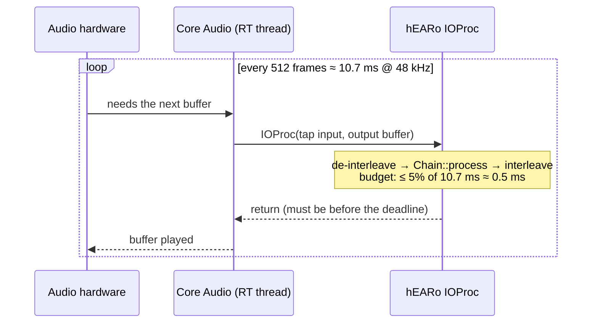

# 02. Real-time audio in Rust

## The deadline you can't miss

At 48 kHz with a 512-frame buffer, Core Audio calls our IOProc every 10.7 ms and expects the
output buffer filled before the hardware needs it. Miss it once and you hear a click or a
dropout. It's like a live gig: the tempo doesn't wait for you to find the next chord.

So the audio thread has one rule: **only do work whose worst-case time is small and known.**



## What breaks the rule

| Operation | Why it's dangerous on the audio thread |
|---|---|
| Allocating (`Vec::push`, `Box::new`, `format!`) | The allocator may take a lock or ask the OS for memory — unbounded time. |
| Locks (`Mutex`) | If the UI thread holds it, the audio thread waits for a *lower-priority* thread (priority inversion). |
| I/O, logging, `println!` | Syscalls and buffered writers block. |
| Panics | Unwinding allocates, and a panic across the C callback boundary aborts. |
| Unbounded loops | Worst case is what matters, not average. |

## How hEARo enforces it

- **Allocate in `prepare`, never in `process`.** Every module sizes its buffers when it learns
  the sample rate and maximum block size (`crates/hearo-dsp/src/module.rs`). `Chain::prepare`
  allocates scratch and delay lines; `Chain::process` only reuses them.
- **Count allocations in tests.** `hearo_testkit::rt::CountingAllocator` replaces the global
  allocator in RT test binaries; `count_allocs(|| chain.process(...))` must return 0
  (`crates/hearo-dsp/tests/rt_safety.rs`, [ADR 0007](../adr/0007-counting-allocator-for-rt-tests.md)).
- **Stress test.** Ten minutes of simulated audio at random block sizes (32–1024), sample rates
  (44.1/48/96 kHz), with random toggles, bypass flips and parameter changes. Checks zero
  allocations, finite output and a bound on sample-to-sample jumps (no clicks at toggles).
- **Fixed-capacity telemetry.** `TelemetryWriter` stores events in a fixed array and counts
  drops instead of growing (`crates/hearo-dsp/src/telemetry.rs`).
- **Never emit NaN.** The chain checks every block; a non-finite block is replaced by the dry
  signal and the modules reset.

## Crossfades instead of switches

Flipping a module on or off instantly is like yanking a fader: the waveform jumps and you hear
a click. The chain fades over 10 ms with a raised-cosine curve (`crates/hearo-dsp/src/fade.rs`).
The gains `g` and `1 - g` always sum to 1, which is right for blending two *correlated* signals
(dry and processed versions of the same audio).

## Latency compensation, like PDC in a DAW

A de-esser with 3 ms lookahead delays its output by 3 ms. Your DAW's plugin delay compensation
(PDC) delays everything else to match. hEARo does the same inside the chain: each slot keeps a
dry delay line as long as its module's lookahead, so a module that's off still delays the signal
by the same amount and toggling never shifts timing. Bypass is a pure delay of the input,
bit-for-bit — the property tests compare with `==`, not "close enough".

## Denormals: the silent CPU spike

When a filter's output decays towards silence, the numbers get so small (below ~1e-38) that the
CPU switches to a slow "subnormal" representation. On many CPUs that's 10–100× slower — a
reverb tail fading out could suddenly blow the deadline. `Chain::process` holds a
`DenormalGuard` (`crates/hearo-dsp/src/denormal.rs`) that sets the CPU's *flush-to-zero* bit
(FPCR.FZ on Apple Silicon) for the duration of the block, so those values simply become 0.

## Audio workgroups (M2, M8)

macOS schedules real-time audio threads together as an *audio workgroup* (`os_workgroup`), owned
by the device. Core Audio's IOProc thread is already in it. If hEARo ever moves ML inference to
its own thread (only if it doesn't fit inline, see [ARCHITECTURE](../ARCHITECTURE.md#real-time-threading)),
that thread must *join the device's workgroup* (`kAudioDevicePropertyIOThreadOSWorkgroup`) so
the scheduler knows its work belongs to the same deadline and gives it a performance core in time.
A plain high-priority thread isn't enough: the OS can't see that it gates the audio deadline.

## Lock-free communication (coming in M2/M3)

- **Atomics** for single numbers (a parameter, a meter value).
- **SPSC ring buffer** (`rtrb`) for a stream of events (a click detected at t).
- **Triple buffer** for "latest value wins" frames (a spectrum for the visualizer).

None of these ever make the audio thread wait.

## Experiments to try

```sh
just signals
just cli process scratch/signals/speech.wav /tmp/out.wav --modules gain --param gain.gain=-6 --report
just bench                    # how many µs does a block cost?
HEARO_STRESS_SECS=3600 cargo nextest run -p hearo-dsp -E 'test(stress)'   # an hour of audio
```

Then add `let _v = vec![0.0f32; 4];` inside `Gain::process` and run `just check`: the RT-safety
test fails and tells you how many allocations happened.
