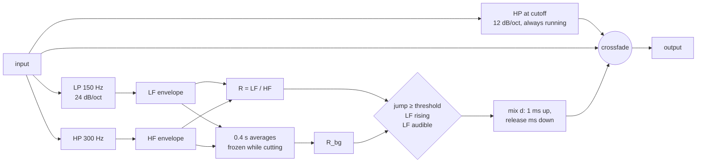

# 04. Filters and biquads

Every EQ band you have ever turned is, under the hood, almost certainly a **biquad**. This deep
dive explains what that is, how the familiar band shapes (high-pass, shelf, bell, notch) relate
to each other, what Q and phase really mean — and then shows how the **de-plosive** module
builds a *dynamic* low cut out of them. (De-hum's notch cascade will join this page when that
module is reworked.)

## What a biquad is

A digital filter computes each output sample from the current input and a few remembered past
samples. A biquad remembers two inputs and two outputs:

```text
y[n] = b0·x[n] + b1·x[n−1] + b2·x[n−2] − a1·y[n−1] − a2·y[n−2]
```

Five numbers (`b0 b1 b2 a1 a2`) decide everything: the band shape, its frequency, its width
and its gain. Changing a plugin's EQ knob just recomputes those five numbers. The `b` side
("feed-forward") creates *zeros* — frequencies the filter can null completely; the `a` side
("feedback") creates *poles* — resonances. Two of each is enough for every classic band
shape, which is why EQs are built from cascades of biquads: a 24 dB/octave high-pass is two
biquads in a row.

hEARo's biquads live in `crates/hearo-dsp/src/filters.rs`. They use the coefficient formulas
from Robert Bristow-Johnson's *Audio EQ Cookbook* (the same ones most plugins use), run in
**f64**, and are written in *transposed direct form II*, which needs only two state variables
and behaves well numerically. Why f64: a narrow notch at 50 Hz puts its poles within 10⁻⁴ of
instability, where f32 rounding would visibly move the notch.

## The band shapes

| Shape | What it does | Typical use |
|---|---|---|
| **High-pass** (low cut) | removes everything below the corner, passes the rest | rumble, wind, plosives |
| **Low-pass** (high cut) | the mirror image | taming hiss, isolating the bass |
| **Low / high shelf** | lifts or lowers everything below/above the corner by a fixed amount | "a bit less bottom" |
| **Bell** (peaking) | boost or cut around a centre frequency | most corrective EQ |
| **Band-pass** | passes only a band around the centre | sidechain / detector filters |
| **Notch** | an extremely deep, narrow cut | hum, a single whistle |

```text
 dB  high-pass          low shelf (−12)      bell (−12, Q 2)      notch
  0 ─        ┌────── ─ ─────┐          ─ ──────┐   ┌────── ─ ────┐  ┌──────
    │       /             \  │                  \_/               ││
-12 │      /               └─┴──────             ↑                 ││
    │_____/                                   centre               ▼ (−∞)
     low ─────── high      low ────── high    low ────── high     low ─── high
```

A few things that are easy to mix up:

- A **high-pass** keeps falling forever (12 dB per octave per biquad); a **shelf** stops at its
  gain. Turning a shelf to −∞ dB *becomes* a high-pass.
- A **notch** is not just a deep bell. A bell cut of −12 dB has a gentle, symmetric dip; a notch
  has a true zero (−∞ dB) exactly at its frequency and is flat a few Hz away.
- **Q** is centre frequency divided by bandwidth. Q 0.7 is wide and musical; Q 10 is
  surgical; de-hum's notches use Q 25 (2 Hz wide at 50 Hz). For high- and low-passes Q shapes
  the corner instead: 0.707 is the flattest possible ("Butterworth") — higher Q makes a bump
  before the slope.
- **Butterworth, 4th order:** two cascaded high-passes at the same corner with Q 0.541 and
  1.307 give a maximally flat 24 dB/octave slope that is −3 dB at the corner
  (`Biquad::BUTTERWORTH4_Q`). Two sections at Q 0.707 would instead be a Linkwitz–Riley
  filter, −6 dB at the corner (crossovers use those).

### Phase: the part EQ graphs don't show

A filter doesn't just change levels, it delays some frequencies more than others. A 12 dB/oct
high-pass shifts the phase by 90° at its corner and by nearly 180° far below it; a 24 dB/oct
one twice that. You rarely hear phase on its own — but you hear it the moment a filtered copy
is **mixed with the original**: where the two are out of phase they partly cancel. That's why
parallel EQ tricks can sound hollow, and it matters for how de-plosive blends its cut in
(below).

## De-plosive: a dynamic low cut

### The problem (HANDOVER §7.4)

A "p" or "b" spoken close to a microphone pushes a puff of air into the capsule. What you hear
is a **pop**: a thump below ~150 Hz, typically 30–80 ms long, that rises within a few
milliseconds and can be louder than the voice itself. A static high-pass at 150 Hz would remove
it — and also the body of every male voice, every bass line and every kick drum. So, like a
de-esser for the low end, hEARo only cuts **while a pop is happening**.

Musician's analogy: it's a dynamic EQ band (think the low band of a multiband compressor, or a
"de-plosive" setting in a channel strip) whose detector listens for something *unusual* in the
low end, not just "loud".

### Detecting a pop without lookahead

De-plosive has **zero latency**: de-smack already uses 40 ms of the 45 ms budget. Plosives are
forgiving here — the pop's energy builds over its first quarter cycle (8 ms at 30 Hz), so a
detector that reacts within a few milliseconds still sees almost all of it coming.

The detector splits the sound into two bands and follows each one's power with a fast envelope
(1 ms attack, 12 ms release, long enough to bridge the zero crossings of a 30 Hz wave):

- **LF:** below 150 Hz (24 dB/oct low-pass) — where pops live;
- **HF:** above 300 Hz (12 dB/oct high-pass) — the "rest of the sound": formants, consonants,
  cymbals, the attack of a bass string.

The key quantity is their **balance** `R = LF / HF`, compared with its background `R_bg` (the
ratio of 0.4 s averages of both bands). The cut engages when **all** of these are true:

| Condition | Default | Why |
|---|---|---|
| `R` jumps above `R_bg` | ≥ *threshold* (12 dB) | a pop moves the balance by 20–40 dB; a bass note or a low voice has a high `R_bg` already |
| LF rises above its own average | ≥ 10 dB | otherwise a syllable *fading out* (HF dies first) or a pause under a steady drone looks like a jump in `R` |
| LF is a real part of the sound | `R` ≥ −10 dB, LF ≥ −50 dBFS | a voice moving to a darker vowel shifts the balance too, but its fundamental stays far below its formants |

Both averages stop learning while a cut is running, so a pop can't raise its own reference.

Why a *balance* and not an LF level? Because the two things that must never be cut — bass-heavy
music and sustained low voices — are loud in the low end all the time. What makes a pop
different is that it arrives **without** the rest of a sound: a kick drum has its beater
click, a plucked bass string its bright attack, a voice its harmonics and formants. A pop is
just air.



The cut stays engaged for at least 15 ms and while the conditions hold within 6 dB of
hysteresis, then releases over *release* ms. If something keeps "popping" for more than
150 ms it isn't a plosive (a drone or a bass note starting from silence): the cut lets go, the
averages adopt the new balance, and it's left alone from then on.

### Cutting without clicks: a crossfade, not a moving filter

The obvious way to build a dynamic low cut is a high-pass whose corner sweeps up and down.
Sweeping filter coefficients every sample is costly, and done carelessly it zippers or
clicks. De-plosive instead runs a fixed **12 dB/oct high-pass at *cutoff*** continuously and
**crossfades** between the untouched input and the filtered copy:

```text
out = (1 − d) · in + d · highpass(in)        d: 0 … d_max,   d_max = 1 − 10^(−max cut / 20)
```

- Well below the cutoff the high-passed copy is nearly silent, so the low end is turned down
  to `1 − d` — 24 dB of *max cut* means `d_max` = 0.937 (the high-pass itself takes 50 Hz
  down 19 dB, 80 Hz 11 dB). Above the cutoff both copies are almost the same and the mix
  changes little.
- `d` ramps up over 1 ms and down over *release* ms. The ramp is applied to a signal that is
  mostly below 150 Hz, so even the 1 ms attack is a smooth bend in the waveform, not a click
  (the golden test checks that the gain never steps by more than one ramp increment).
- Because the filter never stops, it has no start-up transient when a pop arrives.
- When `d` is 0 the output **is** the input, bit for bit — the "no change without a pop" test
  is exact, not approximate.
- This is where phase comes back: mixing a signal with its own high-passed copy partly cancels
  near the cutoff while `d` is in between. A 12 dB/oct high-pass is 90° out of phase at its
  corner, so the dip is at most 4.8 dB there, and only during the ramps. A 24 dB/oct high-pass
  is 180° out at the corner — the crossfade would pass through a full notch on every release —
  and measured only 0.4 dB more pop reduction, so the gentler slope won. A phase-matched
  (all-pass) dry path would avoid the dip entirely, but would change the sound all the time.
- A *cutoff* change is applied only while idle, so a running cut never jumps.

### Parameters

| Key | Name | Range | Default | What it does |
|---|---|---|---|---|
| `threshold` | Threshold | 6–30 dB | 12 | how far the LF/HF balance must jump; lower = catches quieter pops, more risk on music |
| `cutoff` | Cutoff | 80–250 Hz | 150 | corner of the 12 dB/oct high-pass used for the cut |
| `max_cut` | Max cut | 3–36 dB | 24 | how far the lows below the cutoff go down at most |
| `release` | Release | 10–300 ms | 60 | how fast the cut lets go after the pop |

Telemetry: one `Plosive` event per cut (start in the chain-input clock, duration including the
release, and the broadband energy removed during it in dB); the gain-reduction meter shows the
block's maximum low-end cut.

### Measured (golden tests, `crates/hearo-dsp/tests/golden_deplosive.rs`)

| Test | Target | Result |
|---|---|---|
| Pops (−12…−4 dBFS peak) on speech, 44.1/48/96 kHz | LF energy in the pop ≥ 10 dB lower | −13.2…−13.6 dB, all pops found, 0 false events |
| Pops after 2.5 s of room tone (first word after a pause) | ≥ 10 dB | −17.0 dB, 10/10 |
| Speech without pops, 3 sample rates | < 0.3 dB change | 0 events, output bit-identical |
| Music (kick every 0.5 s + plucks), and the same + plucked bass line 41–110 Hz | ≤ 2 events/min, < 1 dB | 0 events |
| Low male voice (90 Hz harmonics, syllables) | ≤ 1 event/min, < 0.3 dB | 0 events |
| Steady 90 Hz sine: under speech / faded in alone / abrupt start | never cut once steady | 0 / 0 / 0 events |
| Block sizes 1, 64, 333, 512, 2048 | identical (≤ 1e-6) | identical; gain never steps faster than the 1 ms ramp |
| Cost (`module_alone`, 512 frames stereo) | chain < 5 % CPU | ≈ 8.4 µs per 10.7 ms block (≈ 0.08 %) |

**Known limits.** With zero lookahead the first few milliseconds of every pop pass uncut —
that (and the 12 dB/oct slope near 80–150 Hz) is what limits the reduction to ≈ 13 dB even
though the cut reaches 24 dB. Pops much *quieter* than the voice (−22…−16 dBFS peaks under −20 dBFS RMS speech) are found later and
less often (≈ 85 % found, ≈ −5 dB): the guard that keeps darker vowels from triggering also
delays them. Lowering *threshold* trades this against music safety. A pop in the first
~100 ms after the module starts may be missed (the averages are still empty). A pure
low tone appearing from silence can, in principle, look like a pop for its first moments; the
150 ms timeout bounds that to one short cut.

## Experiments to try

```sh
just signals                                       # includes speech_plosives.wav and music.wav
just cli process scratch/signals/speech_plosives.wav /tmp/out.wav --modules deplosive --report
# 6 events; the octave table shows about −13…−16 dB at 31.5/63 Hz and ~0 dB from 250 Hz up.
just cli process scratch/signals/music.wav /tmp/music.wav --modules deplosive --report   # 0 events
# Gentler or harder cut, higher corner, slower release:
just cli process scratch/signals/speech_plosives.wav /tmp/out.wav --modules deplosive \
  --param deplosive.max_cut=12 --param deplosive.cutoff=200 --param deplosive.release=150 --report
# More eager detection (watch the event count on music.wav go up):
just cli process scratch/signals/music.wav /tmp/music.wav --modules deplosive --param deplosive.threshold=6 --report
just test-golden deplosive                         # prints the MARGIN lines above
```

Listen for: the pop turning into a soft "p" without a thump; the voice right after it keeping
its body (release too long thins it); and nothing at all happening on music.
