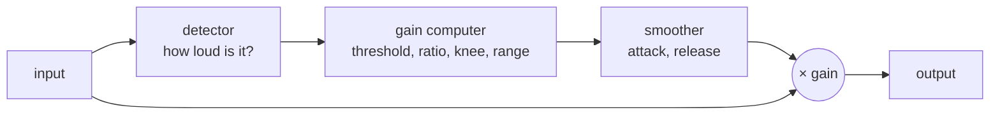
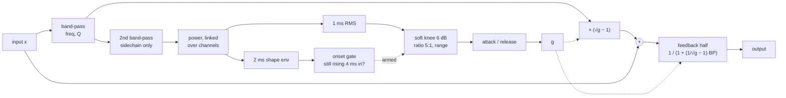
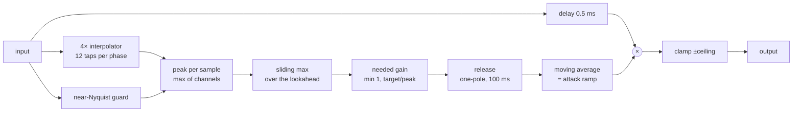

# 05. Dynamics

Dynamics processors change level *over time* depending on the signal itself: compressors,
limiters, gates, expanders and de-essers. This deep dive explains them for someone who has used
them in a DAW, then shows how hEARo builds its own.

## Compressor basics, in plugin terms

Every compressor is the same four boxes:



- **Detector:** turns the waveform into a level (peak or RMS). It listens to the *sidechain*:
  usually the input itself, sometimes a filtered copy of it.
- **Gain computer:** a curve from input level to gain reduction (GR). Below the **threshold**
  nothing happens; above it, every `ratio` dB in gives 1 dB out. A **soft knee** blends the two
  over a few dB so the onset is inaudible. **Range** caps the maximum reduction.
- **Smoother:** **attack** is how fast the reduction grows, **release** how fast it lets go.
  Fast attack catches transients but can distort low frequencies (the gain wobbles within a
  cycle); slow release avoids "pumping" but holds the level down longer.
- **Gain stage:** multiplies the audio by the smoothed gain.

## De-ess

### Spec (HANDOVER §7.2)

- **Purpose:** tame harsh sibilance.
- **Algorithm:** split-band dynamic EQ. A sidechain band-pass (default 5–9 kHz) drives a
  soft-knee downward compressor applied only to that band (Linkwitz-Riley crossover or dynamic
  bell). Musician-style parameters: threshold, range, frequency, Q, attack, release.
- **Latency:** the spec allowed ≤ 3 ms lookahead; the project budget gives de-ess **0**
  (de-smack already uses 40 ms of the 45 ms ceiling, ADR 0011). A fast attack replaces it.
- **Telemetry:** gain reduction (dB) over time, current band centre, trigger count.
- **Golden test:** a synthetic "s" (band-limited noise 6–8 kHz, 120 ms) over a voiced tone →
  burst peak reduced ≥ 6 dB; voiced tone changes < 0.3 dB. Also (our additions): a fast-onset
  "s", a train of bright drum snaps (0 events), `speech_like` (≤ 1 event/min) and `music_like`
  (≤ 2 events/min), both < 0.5 dB in the 5–9 kHz band; identical output for any block size;
  all at 44.1/48/96 kHz.

### What a de-esser is

A de-esser is a compressor whose detector only hears the "s" band, and (in split-band mode)
whose gain only touches that band. Think of it as an EQ bell at 7 kHz whose depth is driven
by a compressor: when an "s" is loud the bell dips, between "s" sounds it's flat. Same idea as
the dynamic-EQ mode in FabFilter Pro-Q or the split-band mode of Pro-DS / Waves DeEsser.

### hEARo's de-esser



- **Sidechain:** two identical band-passes in a row (4th order) at `freq`/`Q`: at the defaults
  (7 kHz, Q 1.0) it hears ≈ 5.1–9.6 kHz and rejects a loud 1 kHz tone by ~34 dB, so loud mids
  don't trigger it. Channels are **linked** (mean power): a stereo image never shifts.
- **The cut is a dynamic bell** with centre gain exactly `g`. It's built from two halves of
  √g each: a feed-forward cut `x + (√g − 1)·bp(x)` and the same band in a delay-free feedback
  loop. Their product is the classic constant-bandwidth peaking EQ: half the dB at the
  band-pass edges, so a −12 dB dip is −6 dB at ≈ 4.3 and 11.3 kHz and only −0.3 dB at
  1 kHz. The depth can change every sample without recomputing filter coefficients.
- **Why not a Linkwitz-Riley crossover?** An LR split sums to an *all-pass*, not to a wire:
  it would shift the phase around the crossover for every sound, all the time. The bell is a
  bit-exact wire when it's idle (`g = 1`), costs three biquads per channel, and never moves
  coefficients at audio rate (no zipper noise). Price: softer band edges than a brick-wall
  band — set `freq`/`Q` to cover the harshness.
- **The onset gate: an "s" keeps rising, a snap doesn't.** A plain threshold only knows *how
  loud* the band is, so the first version fired on every bright drum snap (≈ 240/min on
  `music_like`, −7 dB in the 5–9 kHz band) and on the glottal "buzz" of speech at 96 kHz. With
  no lookahead the only usable cue is how a sound *starts*: a snap, a pick noise or a glottal
  pulse is at its loudest within 1–2 ms and then only decays (a held cymbal or a ringing string
  stays flat); a fricative keeps building for 10–100 ms as the tongue closes in. So when the
  band crosses the bottom of the knee, the gate notes the highest value of a 2 ms band envelope
  over the next **4 ms**, and only allows a cut once the envelope climbs **3 dB above that**
  (within 60 ms). From then on it's an ordinary de-esser until the band falls below the knee.
  A sound that never climbs again is ignored until it fades out or rises 6 dB out of its trough
  (an "s" starting on top of it). Think of it as a transient designer's "attack" detector run
  backwards: transients are what we *don't* want to touch.
- **Ideas that didn't work (measured):** a band-vs-broadband dominance gate (a synthetic snap
  dominates the band more than an "s" over voice does); a "sustain" gate that rejects sounds
  whose envelope falls from its peak within 10–15 ms (music's snaps decay with τ ≈ 8 ms, too
  slowly to tell apart in time — and the 150 Hz pulses of a bright vowel make an "s" over it look
  like it's decaying); a relative threshold against the band's long-term mean (snaps stand out
  of music's average HF as much as an "s" stands out of speech's).
- **Zero lookahead, and what it costs now:** the gate arms ≈ 5–7 ms after the band crosses the
  knee, then the 1 ms attack takes over. A normal "s" (swelling over 30–60 ms) is cut well
  before its peak. An "s" that hits full level within 10 ms lets its first few milliseconds
  through: its first peak is cut only 3–8 dB (median ≈ 7 dB over 20 random bursts), its body
  the full range. That's the price of not ducking drum snaps; lookahead would remove it, but
  the latency budget went to de-smack, which has to see a smack *end* before deciding.
- **Real-time:** at rest and in the gate only linear power comparisons; `log10`/`exp` only
  while the gate is armed. `freq`/`Q` changes glide (20 ms, log domain, every 32 samples on the
  absolute sample clock, so results don't depend on the block size); threshold/range jumps are
  smoothed by attack/release.

| Parameter | Range | Default | Meaning |
|---|---|---|---|
| `threshold` | −60…0 dB | −40 dB | sidechain band level (RMS) where reduction starts (knee centre) |
| `range` | 0…24 dB | 12 dB | deepest cut at the band centre (0 = off) |
| `freq` | 2–12 kHz | 7 kHz | band centre (sidechain and cut) |
| `q` | 0.5–6 | 1.0 | band width; higher = narrower |
| `attack` | 0.1–20 ms | 1 ms | how fast the cut grows |
| `release` | 10–500 ms | 60 ms | how fast it lets go |

Fixed: ratio 5:1, soft knee 6 dB, 1 ms RMS detector; onset gate 2 ms envelope, 4 ms window,
+3 dB rise within 60 ms, +6 dB re-onset.

**Telemetry:** GR meter = deepest cut in each block; one `Sibilance` event per burst (more than
2 dB of cut for ≥ 10 ms) with start, duration (until the *target* cut is back under 0.5 dB, so a
120 ms "s" reads ≈ 80–90 ms, not 220 ms with the release tail) and the in-band energy removed;
`detail` = `[band centre Hz, sidechain level dB, threshold dB, gate state]` (0 idle, 1 watching
an onset, 2 armed, 3 rejected).

### Measured (golden tests, `crates/hearo-dsp/tests/golden_deess.rs`)

| Check | Requirement | Measured (before → after the onset gate) |
|---|---|---|
| 120 ms "s" over a rich vowel: peak (2 ms RMS / sample) | ≥ 6 dB | 7.6/7.1 → 8.2/6.8 dB (48 k), 9.6/8.7 → 9.9/9.4 (44.1 k), 8.4/7.4 → 9.4/9.0 (96 k) |
| … burst energy | ≥ 6 dB | 7.5–8.5 dB |
| … event length (burst 120 ms) | ≤ burst | 220 ms → 79–88 ms |
| Fast "s" (10 ms rise, 60 ms): peak 2 ms RMS / sample | ≥ 3 dB (see below) | 6.9–8.1 / 6.0–8.3 dB |
| … burst energy | ≥ 6 dB | 7.8–8.3 dB |
| Voiced tone (harmonics to 10 kHz, −6 dB/oct) | < 0.3 dB | 0.05 dB during the "s", 5–9 kHz band away from it 0.000 dB (was −3 dB) |
| Snap train (6–8 kHz, 1 ms rise, 5 ms decay, −6 dBFS, 4/s) | 0 events | 119 → 0 events, band −6.0 → 0.000 dB |
| `music_like` (60 s) | ≤ 2 events/min, 5–9 kHz < 0.5 dB | 240 → 0–1 /min, −7.2 → ≤ 0.005 dB |
| `speech_like` (60 s) | ≤ 1 event/min, 5–9 kHz < 0.5 dB | 0 /min (96 k: 104 → 0), ≤ 0.000 dB |
| Block sizes 1/64/333/512/2048 | identical | bit-identical |
| Gain-curve step (7 kHz probe channel) | smooth | ≤ 0.0115 per sample |

The tone/"s" split uses the linked stereo detector with a sum/difference pair: L = tone + s,
R = s − tone. One gain curve processes both, so (L′ + R′)/2 is exactly what happened to the "s"
and (L′ − R′)/2 to the tone; the detector hears tone² + s², like a mono mix (the earlier rig put
the tone alone in R, which diluted the "s" by 3 dB in the linked detector).

The fast "s" requirement is the one place the spec's "≥ 6 dB on the peak" is not met in every
case: over 20 random bursts per sample rate the first peak is cut by a median ≈ 7 dB but at
worst 4.4 dB (2 ms RMS) / 3.5 dB (sample peak), because those first milliseconds are exactly
what a snap also looks like. The test therefore asserts ≥ 3 dB on the peak and ≥ 6 dB on the
burst's energy, and the gap is listed under limits.

### Limits (honest list)

- **Fast-onset sibilants:** an "s" at full level within ~10 ms keeps its first 5–7 ms (peak
  cut 3.5–8 dB instead of ≥ 6). Only lookahead fixes that (see ADR 0012 "shared lookahead").
- **An "s" must rise 3 dB above what's already there:** a quiet "s" under louder bright-voice
  harmonics, or one that starts on top of a ringing cymbal, is armed late or not at all.
- **Affricates** ("ts", "ch") whose plosive burst is as loud as the "s" that follows aren't
  armed (the burst sets the reference). Held, non-rising bright sounds (cymbal wash, a bright
  synth) are deliberately never de-essed.
- The synthetic "s" is wider than its nominal 6–8 kHz (its filters are gentle), and a bell cuts
  its edges less than its centre; real sibilance varies by speaker — tune `freq` by ear.
- No adaptive centre frequency yet (the spec's "adaptive centre" is optional); `detail[0]`
  reports the current centre so a UI can show it.

### Experiments to try

```sh
just signals                                       # includes speech_sibilance.wav (one "s" per second)
just cli process scratch/signals/speech_sibilance.wav /tmp/deess.wav --modules deess --report
# The 8 kHz octave should drop ~9 dB, everything below 2 kHz stays within 0.2 dB; 9 triggers.
just cli process scratch/signals/music.wav /tmp/music.wav --modules deess --report   # false-positive check: 0 events
# Make it gentler or harsher, or move the band:
just cli process scratch/signals/speech_sibilance.wav /tmp/d.wav --modules deess --param deess.range=6 --report
just cli process scratch/signals/speech_sibilance.wav /tmp/d.wav --modules deess --param deess.threshold=-30 --report
just cli process scratch/signals/speech_sibilance.wav /tmp/d.wav --modules deess --param deess.freq=5500 --param deess.q=2 --report
# Live, with de-smack in front (final chain order: deplosive, declick, desmack, deess, limiter):
just cli run --modules desmack,deess --stats
```

## Safety limiter

**Spec (HANDOVER §7.5).** Prevent clipping and protect ears. Always on, last in the chain:
a **true-peak lookahead limiter** with a ceiling of **−1 dBTP**. No output sample — and no peak
*between* samples — may go above the ceiling, and below it the limiter must be transparent
(< 0.1 dB change). Project decision: the lookahead is at most **0.5 ms**, because de-smack
already uses 40 of the 45 ms latency ceiling
([ADR 0011](../adr/0011-desmack-lookahead-and-io-buffer.md)).

Code: `crates/hearo-dsp/src/modules/limiter.rs`; tests: `crates/hearo-dsp/tests/golden_limiter.rs`.

| Parameter | Key | Range | Default |
|---|---|---|---|
| Ceiling | `limiter.ceiling` | −6 … 0 dBTP | −1 dBTP |
| Release | `limiter.release` | 20 … 1000 ms | 100 ms |

Musician's analogy: a brickwall mastering limiter (FabFilter Pro-L, Waves L2, the "True Peak"
switch included) set to −1 dBTP, with almost no lookahead and a medium release. It is a seat
belt, not a loudness tool: on normal material it does nothing at all.

### Sample peak vs true peak

Your DAW's peak meter shows the largest **sample**. But the sound that reaches your ears is the
smooth waveform the DAC rebuilds *through* the samples, and that waveform can swing higher than
any sample. The classic case: a sine at a quarter of the sample rate (12 kHz at 48 kHz) whose
samples land at 45° — every sample sits at 0.707 of the real peak, so the meter reads −3 dB
while the waveform touches 0 dB.

```text
  true waveform:   ╭─╮     ╭─╮        ← peaks here, between samples (0 dB)
                  ╱   ╲   ╱   ╲
  samples:       •     • •     •      ← all at ±0.707 (−3 dBFS on a sample meter)
                        ╲   ╱
                         ╰─╯
```

Those "inter-sample peaks" clip in DACs, in sample-rate converters and in lossy codecs.
A **true-peak** meter (ITU-R BS.1770) oversamples 4× — it estimates the waveform at ¼, ½ and ¾
of each sample step — and reports the largest value in **dBTP**. hEARo's limiter does the same
estimate *before* deciding on gain, so it limits the waveform, not just the dots.

### How it works



1. **Look at the future.** The audio is delayed 0.5 ms (24 samples at 48 kHz). The detector
   sees each sample that long before it is played.
2. **Estimate true peaks.** A small polyphase FIR (a windowed sinc, 12 taps per phase)
   estimates the waveform at the ¼, ½ and ¾ positions. Each sample gets a peak value: the
   largest of the sample and its three in-between estimates, over all channels
   (**stereo-linked**: both channels get the same gain, so the stereo image doesn't move).
3. **Find the worst peak ahead.** A *sliding maximum* over the lookahead window answers "what
   is the loudest thing coming in the next 0.35 ms?" in constant time per sample (a monotonic
   queue in a fixed ring buffer: no allocation, no scanning).
4. **Needed gain** = ceiling ÷ that peak (or 1 if it's below the ceiling).
5. **Release.** When the danger has passed, the gain glides back to unity with a 100 ms
   one-pole curve — slow enough that the gain doesn't follow the individual waves of a bass
   note (that would distort) and fast enough that a single drum hit doesn't duck the next bar.
   The release can only *lower* the target, never raise it above what's needed.
6. **Attack ramp.** A moving average over the attack window (17 samples ≈ 0.35 ms at 48 kHz)
   turns the stepwise target into a straight ramp that reaches the needed gain *exactly when*
   the peak arrives. That works because every value in the average has already seen the peak,
   so the average can't be above the needed gain at the peak. No overshoot, no hard steps.
7. **Backstop.** A final clamp to ±ceiling guarantees the *sample* peak in rounding corner
   cases; on real material it never touches the signal.

Below the ceiling the gain is exactly 1.0 and the limiter is a bit-exact 0.5 ms delay.

### Why 0.5 ms is tight, and the near-Nyquist guard

Mastering limiters use 1–5 ms of lookahead; we get 0.5 ms. Of that, 6 samples go to the
interpolator (it needs 6 samples of future to estimate between two samples), 2 to a guard
around each peak, and the rest is the attack ramp.

The hard part is content close to Nyquist (above ~20 kHz at 48 kHz: cymbal and noise "air",
synthetic noise bursts). What such content does *between* samples depends on samples further
in the future than we can see; no short interpolator can know it. Measured: noise peaks were
under-read by up to 1.5 dB. So the limiter also measures how much near-Nyquist content there
is (a high-order difference that ignores everything below ~0.3·fs) and adds it to the peak
estimate. That makes it conservative exactly where it's blind:

| Material | What happens |
|---|---|
| Speech, music, anything with little energy above ~15 kHz | the guard reads ≈ 0; limiting as usual |
| Hot noise and drum snaps with full-band content | a little more gain reduction (≈ 0.1–1 dB) |
| A hot pure tone at 0.42·fs (20 kHz at 48 kHz) | limited ≈ 5.4 dB more than needed — safe, and such a tone is inaudible anyway |

Plus 0.2 dB of internal headroom, of which the golden tests use ~0.1 dB.

### What the golden tests measure

The tests use an independent reference meter (4×, 64 taps per phase — far more accurate than
the limiter's own estimate) at 44.1, 48 and 96 kHz.

| Check | Result |
|---|---|
| Max true peak, hot sines (+6/+12 dBFS, 50 Hz … 0.42·fs), fs/4 at 45°, square waves, pink noise +6 dBFS RMS (4 seeds), white noise, speech +10 dBFS, music/drums +10 dBFS | worst −1.10 dBTP (pink noise; ceiling −1) |
| Sample peaks | never above the ceiling (also a property test: random hot noise/tones, random block sizes and ceilings) |
| Transparency: speech at −20 dBFS RMS, and the same speech at −1.5 dBTP | bit-exact delay (0 samples changed) |
| Over-limiting: hot material ends within 1.5 dB of the ceiling | yes, except near-Nyquist signals (by design, above) |
| Smoothness | gain moves ≤ 0.045 per sample; output never jumps more than the input did |
| Block sizes 1, 64, 333, 512, 2048 | identical output, bit for bit |
| Latency | 22 / 24 / 48 samples at 44.1 / 48 / 96 kHz (≤ 0.5 ms), exact |
| Cost | ≈ 25 µs per 512-frame stereo block (0.2 % of one core) |

### Telemetry

The gain-reduction meter shows the block's maximum reduction. A `Limit` event is pushed once
per engagement: when the reduction first exceeds 1 dB, ending when it falls back under 0.5 dB
(hysteresis), with the engagement's start, length and deepest reduction. A continuous
overload is reported once per second so it stays visible.

### Experiments to try

```sh
just signals
# Normal speech: the limiter does nothing (peak before = peak after, 0 events).
just cli process scratch/signals/speech.wav /tmp/out.wav --modules limiter --report
# Push music 18 dB into the limiter: peaks stop at −1.2 dBFS, one event per second of limiting.
just cli process scratch/signals/music.wav /tmp/out.wav --modules gain,limiter --param gain.gain=18 --report
# A lower ceiling and a faster release: listen to /tmp/out.wav for pumping.
just cli process scratch/signals/music.wav /tmp/out.wav --modules gain,limiter \
  --param gain.gain=18 --param limiter.ceiling=-6 --param limiter.release=20 --report
# The margins and the per-signal true-peak table:
cargo nextest run -p hearo-dsp --test golden_limiter --no-capture
```

Try a release of 20 ms on the +18 dB music: the gain starts to follow individual bass waves,
which you hear as a gritty, distorted low end — the reason the default is 100 ms.
