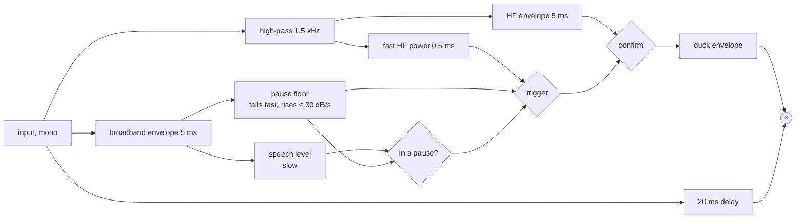
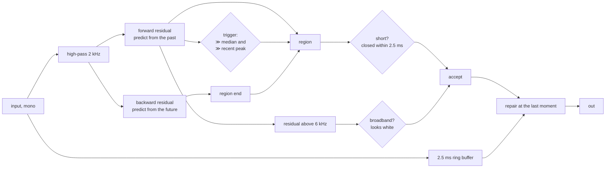

# 06. Click and smack detection and repair

This deep dive starts with the module the human asked for first: **de-smack (pause-aware)**,
which removes lip smacks in speech pauses. The second half covers the LPC-based **de-click** for
tiny clicks *inside* speech or music (§7.3). The ML de-smack for smacks *overlapping* words
(§7.6) builds on the same ideas later.

## What a lip smack looks like

Moist lips sticking together and separating after a pause make a short, bright transient.
Measured on the human's own captures (8 s snapshots saved with `§`):

| Property | Typical value |
|---|---|
| Length | 5–15 ms (plus a short tail) |
| Level | 15–25 dB above the pause it sits in |
| Spectrum | broadband, strongest above ~1.5 kHz, often a small low "thump" |
| Context | a pause before it; speech often starts right after |
| When the human pressed `§` | 0.5–2 s after hearing it |

Musician's analogy: a de-esser listens to one band and turns it down when it gets loud. De-smack
is closer to a **gate in reverse with lookahead**: it opens a very short "duck" exactly around a
sound that shouldn't be there, and leaves everything else alone.

## The detector



All five conditions must hold (`crates/hearo-dsp/src/modules/desmack.rs`):

1. **Burst:** the fast HF power jumps ≥ *threshold* (14 dB) above the **pause floor**. The floor
   follows the smoothed level down within milliseconds when speech ends, but may only rise
   30 dB per second — so a 10 ms smack can't lift the floor it's measured against.
2. **In a pause:** the floor is ≥ *pause depth* (15 dB) below the recent speech level, and the
   quiet had lasted ≥ 8 ms when the burst arrived. This rejects the spiky last glottal pulses of
   a syllable fading out, which otherwise look like bursts.
3. **Dies away fast (HF):** within 40 ms the HF envelope drops 12 dB from its peak. An "s"
   or "sh" after a pause keeps going, so it's never confirmed.
4. **Dies away fast (everything):** the broadband envelope also drops 6 dB. A drum hit's noisy
   "snap" decays fast, but its body keeps sounding — that's what separated drums from smacks.
5. **Then stays quiet** for 20 ms at the pause floor. This is what separates a smack from a
   **stop consonant** ("t", "k", "p"): a closure looks like a pause and the burst decays as
   fast, but aspiration or voicing follows within 5–20 ms. (Measured: 10 ms of required quiet
   still dulled 26 % of stops, 20 ms → 2–4 %; [ADR 0011](../adr/0011-desmack-lookahead-and-io-buffer.md).)

The 40 ms **lookahead** is what makes conditions 3–5 possible: the module sees the future of
the burst before it reaches the output, so it can wait to be sure and still start ducking 1 ms
*before* the onset. Decay is judged on 2 ms envelopes — voiced speech's pulses dip between
periods, but voiced speech never stays quiet for 20 ms, so condition 5 rejects it.

**Long smacks don't fit in 40 ms** (human-labelled miss, 2026-11-14). A real smack can be
several ticks over ~30 ms plus a room tail decaying ~1 dB/ms: burst + tail + 20 ms of quiet
≈ 60 ms, so it was confirmed only after its loudest part had already played (and the old age
limit dropped it at exactly 60 ms anyway). Three changes:

- **Another tick re-opens the event** (within 40 ms of the onset) instead of counting as
  "sound rose again". Voicing after a stop rises too, but never decays again within 40 ms.
- **Provisional duck at the deadline:** when the burst is about to reach the output and its
  tail is already back at the pause floor (≥ 2 ms), ducking starts while the 20 ms check
  continues. If the sound rises again, the duck is released smoothly (5 ms) long before that
  sound reaches the output, and no event is reported. Short stop bursts finish their quiet
  check before the deadline, and a stop's aspiration sits ≥ 11 dB above the floor there, so
  they aren't affected (stops ducked stays 4 %).
- The age limit applies to burst + tail reaching the floor, not to the quiet check after it.

Measured: the labelled clip −17 dB over the labelled region (−24 dB at its loudest part); on
synthetic long smacks the part after the first 8 ms is ducked by a median 21–23 dB. **The first
~8 ms (first tick) of a loud long smack still plays**: deciding before it would need ≈ 50 ms of
lookahead (≈ 55 ms total latency) — the human's call.

**Slow tails** (human-labelled miss, 2026-11-14, a close-mic demo recording). Two ticks peaking
~55 dB above a −64 dB floor, then a 4–8 kHz wet hiss plus a < 150 Hz thump, ~30 dB down and
decaying only ≈ 0.3 dB/ms, so the tail reached the floor ~120 ms after the onset. The 60 ms
limit dropped it as "too long" (the de-esser then took 10 dB off part of the hiss — inaudible).
**Not fixed, on purpose.** Tried: accept a tail that keeps falling at a moderate rate (5 ms
level, 0.7–3 dB per 5 ms, three checks in a row, ≥ 20 dB below the peak) and let it take up to
200 ms. It caught synthetic copies of the clip (0/29 → 29/29, tails −24 dB) but the DSP review
rejected it:

- A **word-final stop released into a pause** ("that." — burst, fading aspiration, silence) is
  physically the same thing: a burst with a slowly decaying noise tail and quiet after it.
  On stops with weak or fading aspiration it ducked 12–27 % of them (0–3 % before). The 60 ms
  limit is what spares them; it isn't arbitrary.
- An envelope's own release after a burst drops onto a plateau also "falls at a moderate rate"
  for up to three 5 ms steps (from 6 dB above: 2.8, 1.75, 0.9 dB), so a rate test alone can't
  separate a decaying tail from a flat one early on.
- The existing stop test couldn't see the damage: it counts reported events, and a provisional
  duck that is released reports none. Follow-up: measure stops per burst + aspiration, add
  weak/decaying-aspiration and utterance-final variants (PROGRESS backlog).
- Even then the clip's ticks still played: at the 40 ms deadline its tail had dropped 27 dB and
  wobbled flat for 10 ms, the same picture as a stop with aspiration 30 dB down.

What would fix it: seeing whether speech follows (≈ 60–100 ms lookahead, over the 45 ms ceiling
— OPEN_QUESTIONS H3), or a learned discriminator (the ML stage; this clip is a labelled
example).

## The repair: ducking, not cutting

A confirmed smack is turned down to about the pause floor (+3 dB), at most *range* (24 dB): a
1 ms fade in before the onset, a hold while the smack (including its low thump) lasts, and a
5 ms fade out — ending early if speech starts again. Cutting time out isn't possible in live
audio, and attenuating to the room tone sounds natural: the listener hears a short quiet pause.

## How we got here (tuning log)

| Step | Recall | FP/min speech | FP/min music | Smack −dB | What we learned |
|---|---|---|---|---|---|
| v0 | 0.17 | 6 | 39 | — | background followed speech tails too slowly |
| fast-falling floor | 0.76 | 178 | 73 | — | instantaneous power dips at zero crossings |
| smoothed floor, slew-limited rise | 0.79 | 50 | 2 | 5.7 | syllable tails look like bursts |
| require ≥ 8 ms pause before | 1.00 (probe) | 0 | 6.5 | 5.7 | reporting bug + duck ended early |
| broadband-based duck end, 5–20 ms smacks | 0.93–0.95 | 0 | 6.5 | 13–17 | drum hits confirm (snap decays) |
| broadband decay required too | 0.93–0.95 | 0 | 0 | 13–17 | DSP review: stops ducked 44 %, duck depended on block size |
| linked stereo (mid/side power), render-then-delete, ≥1 ms fade | 0.93–0.95 | 0 | 0 | 13–17 | stops still 26 % |
| stay quiet 20 ms + 40 ms lookahead | 0.93–0.95 | 0 | 0 | 13–17 | stops 2 %, but **real smacks: 2/19** — 5 ms envelopes too slow for real room tone |
| 2 ms decay envelopes, age limit on the burst only | 0.93–0.95 | 0 | 1 | 13–17 | stops 4 %; real: 14/19 |
| re-open on ticks + provisional duck (long smacks) | **0.93–0.95** | **0** | **1.5** | **13–17** | stops 4 %; long smacks 0.83–0.97, −21…−23 dB after 8 ms; **real labelled regions ≥ 10 dB: 5/23 → 17/23** (17/34 with the 11 snapshots added later) |
| *(rejected)* settling slow tails | 0.93–0.95 | 0 | 1.5 | 13–17 | loud slow-tailed smacks 0/29 → 29/29, but word-final / weak-aspiration stops 12–27 % ducked (released ducks, invisible to the stop test) |

**Real snapshots (19 clips, the human's `§` presses):** a smack is ducked 0.3–2.5 s before the
press in 14 of 19 clips, by 12–24 dB, almost always exactly one per clip. Synthetic tests are
proxies — the real clips overruled them once already (the 2/19 row above).

## Limits (honest list)

- Smacks **overlapping speech** aren't handled — the "in a pause" condition is the whole point.
  That's the ML stage (§7.6).
- Long multi-tick smacks: the first ~8 ms can play before the provisional duck starts (above).
- Loud close-mic smacks whose tail takes > 60 ms to settle are not touched at all (above).
- A smack within ~80 ms of speech ending is measured against a pause floor that is still
  settling (up to 12 dB high), so its duck can end while the tail is still audible.
- Stop consonants: 2–4 % still ducked on synthetic stops — real speech is the test; report
  dulled consonants with "false hit" snapshots.
- **Latency:** 40 ms lookahead + a 128-frame IO buffer ≈ 43 ms added (target ≤ 30, ceiling 45;
  ADR 0011). A smack immediately followed by speech (< 20 ms) is deliberately left alone.

## Experiments to try

```sh
just signals                                    # includes speech_smacks.wav
just cli process scratch/signals/speech_smacks.wav /tmp/out.wav --modules desmack --report
# Process one of your own snapshots and A/B in QuickTime:
just cli process ~/Library/Application\ Support/hEARo/snapshots/<file>.wav /tmp/clean.wav --modules desmack --report
# Make it more or less eager:
just cli run --modules desmack --param desmack.threshold=10   # catches quieter smacks
just cli run --modules desmack --param desmack.range=12       # gentler duck
cargo test -p hearo-dsp --lib probe -- --ignored --nocapture  # the tuning probe
```

## De-click (LPC + AR interpolation)

De-smack handles smacks that sit in *pauses* by turning them down. A click *inside* a word or a
note can't be turned down — the speech under it would go too. De-click (§7.3,
`crates/hearo-dsp/src/modules/declick.rs`) instead **cuts the click out and redraws the
waveform underneath it** from what came before and after. In the chain it runs after
de-plosive and before de-smack.

| | Mouth click / tick | Lip smack |
|---|---|---|
| Length | 0.2–2 ms (spec: up to 5 ms) | 5–30 ms |
| Where | anywhere, often inside speech | in pauses |
| Repair | replace the samples (interpolate) | duck (turn down) |
| Module | de-click | de-smack |

### Spec and the one decision that shapes everything

- Detect: high-pass > 2 kHz, LPC residual (order 16–32), flag samples where the residual exceeds
  k × a robust running level, merge flags into regions, pad them.
- Must not trigger on drum hits, plucked notes or plosives: short *and* broadband only.
- Repair by **autoregressive (AR) interpolation** (Janssen/Godsill least-squares AR, "LSAR").
- **Lookahead ≤ 2.5 ms.** The spec suggested 5–10 ms, but de-smack already uses 40 ms of the
  45 ms ceiling (ADR 0011), so the project gave de-click 2.5 ms. The region *and some context
  after it* must be known before the region's first sample leaves the module. So clicks up to
  ~2 ms can be repaired; longer ones are left untouched (by design: a half-repaired click is
  worse than none). This budget is also what caps the repair quality (below).

### Detection, for a musician: "how surprising is this sample?"

**Linear prediction (LPC)** guesses each sample as a weighted sum of the previous 16. Fit the
16 weights to the last 10 ms and the guess is excellent for anything with a "shape" — a
sustained note, a vowel's formants, even steady hiss (whose spectrum it whitens). The
**residual** — actual minus guess — is the part the recent past didn't predict: the
*surprise*. A click is pure surprise: one moment nothing, the next a spike. Think of the LPC as
a de-esser-style sidechain that has learnt the song so far and only reacts to what's new.



- **Robust level.** The residual's running *median* (a quantile tracker that steps up or down
  by a fixed number of dB per sample) is the MAD-like "normal surprise". A click must be ≥ 20 dB
  above it. It moves 40 dB in 50 ms, so it follows speech but not a 2 ms click.
- **Recent peak.** Voiced speech is a train of glottal pulses, and each pulse is a little
  surprising too. Requiring the residual to be ≥ 8 dB above the recent *peak* (30 ms decay,
  learning only from residuals ≥ 0.15 ms old so a click's own onset doesn't raise its bar)
  rejects a pulse that is about as big as the last one.
- **Start and end.** A click smears the forward residual over the 16 samples *after* it.
  Predicting backwards (each sample from the 16 after it — the lookahead makes those
  available) smears it *before* it instead. Forward finds the start, backward finds the end, so
  a 2-sample click gets a ~5-sample region instead of ~20.
- **Short.** A region closes after 0.4 ms without flags. If it is still open when its first
  sample is due at the output, it's too long: drum snaps, plucks' noisy attacks, fricatives and
  plosives all last longer than 2 ms. Rejected; 10 ms lockout.
- **Broadband.** A click's residual is white; glottal pulses and formant ringing leave theirs
  between 2 and 6 kHz. The share of residual energy above 6 kHz must reach 85 % of what white
  noise would have (≈ 0.82 at 48 kHz; measured: clicks ≥ 0.85, speech triggers ≤ 0.6).
- **Sensitivity** (0–1, default 0.5) moves both trigger thresholds by ±12 dB.

### Repair: redraw the waveform

**AR interpolation** treats the audio around the click like a resonator: fit a 32-pole model
(Burg's method) to the 10 ms before the click, then choose the replacement samples so that the
whole stretch — before, gap, after — is as *predictable* as possible under that model (least
squares over every prediction error that touches the gap). Musically: it continues the
partials that were ringing into the gap and lands on the ones ringing out of it.

Three things made it work at 2.5 ms of lookahead (tuning log below):

1. **A well-conditioned solver.** The normal equations of a sharp model of a chord are hopelessly
   ill-conditioned; the least-squares problem is solved directly with banded Givens QR
   (O(m·p²)) instead.
2. **A regularised model.** Burg is told there is white noise 35 dB below the context. Without
   it, a sharp model turns tiny leftovers of the click in the short post-context into huge
   errors in the gap.
3. **A low-band anchor.** At 48 kHz speech and music live mostly far below Nyquist; an AR model
   barely constrains slow, smooth deviations, and plain LSAR fills long gaps with audible low
   "bumps". A click has almost no energy below ~1.5 kHz, so the solver is also asked to keep the
   region's content below 1.5 kHz close to what was there (a zero-phase FIR penalty inside the
   same least-squares problem). That's the key trick: *redraw only what the click damaged.*

The repair happens at the last possible moment (just before the region's first sample is
output), per channel, so it sees as much post-context as the lookahead allows (≤ 0.7 ms).
Detection uses the channel average; a click in one channel is found at half level and repaired
in both channels with each channel's own model.

### Results (golden tests, synthetic clicks 0.2–2 ms, −30…−12 dBFS peak, on −20 dBFS material)

| Measure | Spec | speech 48k | tonal 48k | 44.1 kHz | 96 kHz |
|---|---|---|---|---|---|
| Recall | ≥ 95 % | 100 % | 100 % | 100 % | 100 % |
| False positives / min (speech, music with drums + plucks, ± −60 dB floor, chord) | ≤ 1 | 0 | 0 | — | 0 (music) |
| Residual click energy | ≤ −20 dB | **−14.2 dB** | **−14.2 dB** | −14.6…−16.6 dB | −11.2…−16.5 dB |
| Repaired-region SNR vs clean | ≥ 25 dB | **24.7 dB** | **22.6 dB** | 21.6–23.5 dB | 23.4–26.6 dB |
| Same output for block sizes 1/64/333/512/2048 | ≤ 1e-6 | bit-identical | | | |

Recall and false positives meet the spec. **Residual energy and SNR do not**: at 44.1/48 kHz, short clicks
(< 0.7 ms) reach −16…−20 dB and 21–28 dB, 1.3–2 ms clicks −12…−20 dB. The limit is the
interpolation itself: with ≤ 0.5 ms of post-context and a model regularised to −35 dB, the same
solver on the *clean* chord (no click at all) reaches 40 dB over 0.4 ms gaps but only 28 dB over
1.25 ms and 25 dB over 1.9 ms. The golden tests assert the measured values (−2 dB margin) and
document the gap; more lookahead is the lever if listening tests ask for it.

`music_like` contains real clicks: every Karplus–Strong note is cut off while still ringing
(a step 1.15 s after each beat). De-click finds most of those (that's correct); the false-positive
count excludes them.

**CPU** (`cargo bench -p hearo-dsp --bench chain -- module_alone`, 512-frame stereo, 48 kHz):
≈ 36 µs per block without clicks (≈ 0.34 % of a core). Each repair costs ≈ 100 µs (both
channels); with 20 clicks/s the mean is ≈ 73 µs/block and a block with two or three repairs
≈ 0.4 ms. A token bucket caps repairs at 20/s on average (burst 8), so noise-like input that
"clicks" constantly can't eat the budget.

### How we got here (tuning log)

| Step | Speech: residual / SNR | Tonal: residual / SNR | What we learned |
|---|---|---|---|
| Hann-autocorrelation AR + banded Cholesky | +6 / 4 dB (worse!) | +4 / 4 dB | normal equations of a sharp model are singular in practice |
| Burg + Givens QR | still worse than the input | still worse | solver fine now; the error is a slow low "bump" across the gap |
| repair only the band above 1.5 kHz (split filter) | −3 / 13 dB | −14 / 22 dB | right idea, but the split filter smears the click into the context |
| low-band anchor inside the LSAR | −13 / 23 dB | −16 / 24 dB | best fix; recall now limits speech |
| broadband check on the *residual*, not raw bands | −13 / 24 dB, recall 1.0 | | raw 2–6 vs > 6 kHz energy is swamped by speech under quiet clicks |
| f64-phase test chord (f32 `sine` phase noise had been hiding an instability) | | +13 / −5 dB | perfectly clean tones need a regularised model |
| Burg noise floor −35 dB, merge tail re-triggers | −14 / 25 dB | −14 / 23 dB | robustness vs accuracy trade-off |
| backward residual for the region end | −14 / 25 dB | −14 / 23 dB | short clicks get short regions |
| refit every 4 ms, 10 ms AR window, anchor rows every 4th sample, repair cap | same | same | CPU 52 → 36 µs/block, ≈ 175 → 100 µs/repair |

### Limits (honest list)

- **Click length ≤ ~2 ms** (lookahead). Longer clicks are left alone; `speech_clicks.wav`
  (0.2–5 ms clicks) shows it: about half the clicks are repaired.
- **Repair quality** below the spec targets (see above); worst on 1–2 ms clicks over dense
  harmonic material. At 96 kHz, speech clicks < 0.7 ms are only reduced ~9 dB (not yet
  understood).
- Detection on the channel average: a click with opposite polarity in L and R cancels.
- Clicks closer than ~0.5 ms to a strong glottal pulse can be merged with it and rejected as
  "too long" (seen once while tuning).
- Real mouth clicks are the test that matters; tune on "missed"/"false hit" snapshots.

### Experiments to try (de-click)

```sh
just signals                                   # speech_clicks.wav: 2 clicks/s, 0.2–5 ms
just cli process scratch/signals/speech_clicks.wav /tmp/out.wav --modules declick --report
just cli process scratch/signals/music.wav /tmp/m.wav --modules declick --report   # finds the note cut-offs
just cli process scratch/signals/speech_clicks.wav /tmp/s.wav --modules declick --param declick.sensitivity=0.9 --report
# Per-length breakdown and the tuning numbers:
cargo test -p hearo-dsp --test golden_declick -- --nocapture 2>&1 | grep MARGIN
cargo test --release -p hearo-dsp --test golden_declick timing_probe -- --ignored --nocapture
```
